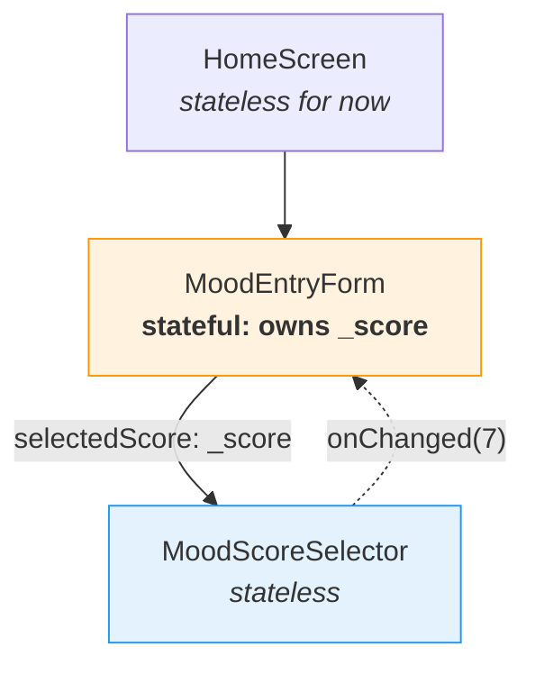
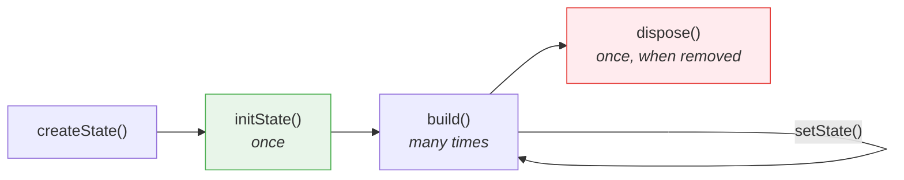
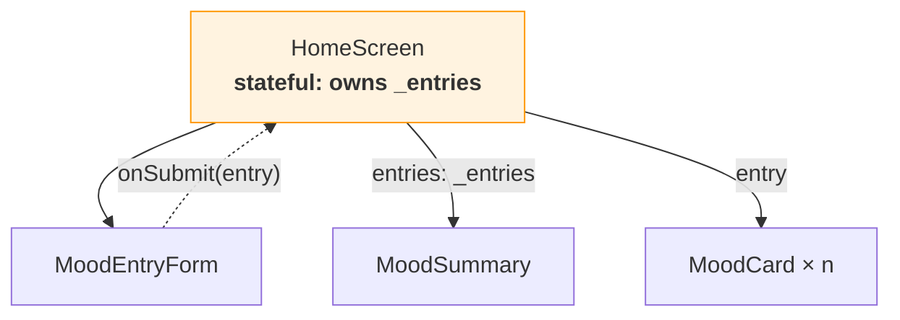
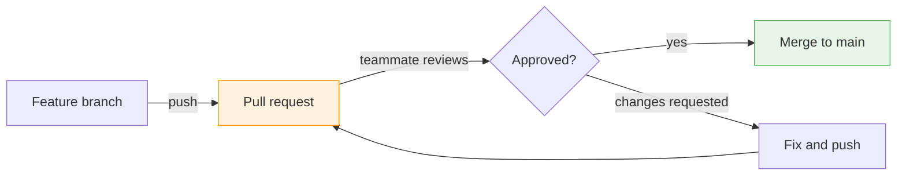

# Lab 4: Interaction and Local State

<div class="lab-meta" markdown>
<div class="lab-meta__row"><span class="lab-meta__label">Course</span> Multiplatform Mobile Software Engineering in Practice</div>
<div class="lab-meta__row"><span class="lab-meta__label">Duration</span> 90 min in class + team setup at home</div>
<div class="lab-meta__row"><span class="lab-meta__label">Prerequisites</span> Lab 3 and A3; Lecture 3 (engineering workflow and agentic SDLC); Lecture 4, earlier in this meeting</div>
</div>

<div class="grid cards" markdown>

- :material-target:{ .lg .middle } **Learning Objectives**

    ---

    By the end of this lab, you will be able to:

    - [ ] Build a widget that reports user actions to its parent through a callback
    - [ ] Decide which widget should own a piece of state, and change it with `setState`
    - [ ] Use a `TextEditingController` and release it in `dispose()`
    - [ ] Move state up to the widget that shares it with others ("lifting state up")
    - [ ] Turn a requirement into acceptance criteria before any code is written
    - [ ] Delegate a bounded change to a coding agent, review the diff, verify it yourself, and record the evidence in a pull request

- :material-clock-outline:{ .lg .middle } **Time Estimate**

    ---

    | Section | Duration | Priority |
    |---------|----------|----------|
    | Setup | ~5 min | Core |
    | Part 1: Where state lives | ~25 min | Core |
    | Part 2: Saving an entry | ~30 min | Core |
    | Part 3: Agent-assisted validation | ~20 min | Core |
    | Part 4: Team formation | ~10 min | Core |
    | Team setup | at home | Before Lab 5 |

</div>

!!! info "Task modes in this lab"
    **Parts 1 and 2 are independent work**: no AI coding tools. **Part 3 is your first agent-assisted task**: you delegate one bounded change to a coding agent, and you stay responsible for the result. The workflow is the one from Lecture 3: requirement → acceptance criteria → plan → implementation → verification → human review.

!!! note "Which coding agent? Set it up before the lab"
    The course supports two agents. Choose one and have it working **before** this lab:

    - **GitHub Copilot** in VS Code (agent mode). It is free for students verified through [GitHub Education](https://docs.github.com/en/copilot/how-tos/copilot-on-github/set-up-copilot/enable-copilot/set-up-for-students). Verification can take several days, so apply early.
    - **Mistral Vibe** in the terminal, in VS Code or on the web. Mistral's [free plan](https://mistral.ai/pricing) includes a limited number of coding sessions (Mistral does not publish the exact limit). Verified students can also get the full plan at a discount.

    Without access to either, you can do Part 3 yourself by following the same steps; see the end of Part 3.

---

## Setup (~5 min)

The starter is the finished Lab 3 app (Checkpoint 01) plus skeletons for two new widgets. This time you will also put it under version control, because Part 3 ends with a pull request.

```bash
cd course-materials
git pull
mkdir -p ~/flutter-work/lab4
cp -r labs/lab-04-interaction-state/starter/mood_tracker ~/flutter-work/lab4/
cd ~/flutter-work/lab4/mood_tracker
flutter create --platforms=android,ios .
flutter pub get
git init
git add .
git commit -m "Start from the Lab 4 starter"
```

`flutter create` also adds a `.gitignore`, so build output stays out of your commits. Add `web` or your desktop platform to `--platforms` if you want a resizable window.

Run the self-check now:

```bash
flutter test
```

Both tests fail. They pass once Part 2 is done.

---

## Part 1: Where State Lives (~25 min)

!!! abstract "TL;DR"
    A widget that only displays something and reports taps can stay **stateless**. The value that changes (the selected score) belongs to the **nearest widget that needs it**, which keeps it in a `State` object and changes it with `setState`.

In this part you build the score picker and decide where the selected score is stored:



Data flows **down** through constructor parameters; events flow **up** through callbacks.

### 1.1 Exercise 1.1: The score selector

Follow `TODO 1.1` in `lib/widgets/mood_score_selector.dart`. The selector shows ten `ChoiceChip`s and calls `onChanged` with the tapped score. It does not remember anything itself.

`ValueChanged<int>` is just a name for "a function that takes an `int` and returns nothing", so `onChanged(score)` calls whatever function the parent passed in.

When your chips appear, try the experiment in the `TODO`: swap the `Wrap` for a `Row` and look at the app on a narrow phone.

??? success "What happens with a Row?"
    Ten chips are wider than a phone screen, and a `Row` never moves children to a new line, so it overflows. You met the same error in Lab 3. A `Wrap` places as many children as fit on a line, then starts another line.

### 1.2 Exercise 1.2: Put the form on the screen

Follow `TODO 1.2` in `lib/screens/home_screen.dart`, then run the app. The form shows the chips, but tapping one does nothing yet.

### 1.3 Exercise 1.3: Make the selection stick

Follow `TODO 1.3` in `lib/widgets/mood_entry_form.dart`: store the tapped score in `_score` inside `setState`, and pass `_score` to the selector.

Then do the experiment: remove the `setState` call but keep the assignment, and tap a chip.

??? success "Why nothing happens without setState"
    `_score` does change in memory, but Flutter does not know that. `setState` tells Flutter that this widget's state changed, so Flutter calls `build()` again and the chip appears selected. Without it, the screen keeps showing the old build.

??? question "HomeScreen is stateless. How can the form remember a selection?"
    The selection is stored in the form's `State` object (`_MoodEntryFormState`), not in `HomeScreen`. Flutter keeps that `State` object alive while the form stays in the same place in the widget tree, even when its parent rebuilds. A stateless parent can have stateful children.

### Self-Check: Part 1

- [ ] Tapping a chip selects it, and only one chip is selected at a time.
- [ ] You can explain why the selector is stateless while the form is stateful.
- [ ] You saw what happens without `setState`, and why.

---

## Part 2: Saving an Entry (~30 min)

!!! abstract "TL;DR"
    A `TextEditingController` holds the text of a field; create it with the `State` and release it in `dispose()`. To make a saved entry appear in the history, move the list up into the widget that owns both the form and the history: `HomeScreen`.

### 2.1 Exercise 2.1: A controller, and when to dispose of it

A `State` object has a lifecycle:



A `TextEditingController` holds resources and listeners, so whoever creates it must also release it. Follow `TODO 2.1`: declare `_noteController` as a field and override `dispose()`.

??? success "Why does a controller need disposing when an int does not?"
    An `int` is a plain value that Dart's garbage collector cleans up. A controller keeps a list of listeners that it notifies whenever the text changes. If nobody calls `dispose()`, those listeners stay registered after the form has gone: a memory leak.

### 2.2 Exercise 2.2–2.3: The note field and the Save button

Follow `TODO 2.2` and `TODO 2.3`. While no score is selected, pass `onPressed: null`: Flutter shows a disabled button. After saving, clear the form (`_score = null` inside `setState`, and `_noteController.clear()`).

Run the app and save an entry. The form clears, but the entry does not appear in the history. Why not?

### 2.3 Exercise 2.4: Lift the list up

The form creates the entry, but the history and the summary belong to `HomeScreen`. The widget that owns the list must be the one that shows it, so `HomeScreen` becomes stateful and the form hands each new entry up through `onSubmit`:



Follow `TODO 2.4` in `lib/screens/home_screen.dart`, and remember to update `lib/main.dart`.

??? question "Why copy the list with List.of() instead of using widget.initialEntries?"
    `initialEntries` belongs to the caller; here it is the shared `sampleEntries` list. Inserting into it would change data that this widget does not own, and anything else that uses `sampleEntries` would change too. The copy belongs only to this `State`.

Run `flutter test`: both tests should pass. In the app, save an entry and check that the history and the average both update.

!!! warning "Nothing is saved yet"
    Press ++shift+r++ and your new entries disappear: state lives in memory only. Saving data on the device comes in Lecture 7.

### Self-Check: Part 2

- [ ] Saving an entry puts it at the top of the history and updates the summary.
- [ ] **Save entry** is disabled until a score is chosen.
- [ ] `_noteController` is disposed in `dispose()`.
- [ ] `flutter test` passes.

Commit your work:

```bash
git add lib
git commit -m "Add the mood entry form"
```

---

## Part 3: Agent-Assisted Validation (~20 min)

!!! abstract "TL;DR"
    Write the acceptance criteria yourself, before any AI tool sees the task. Then let the agent plan and implement, review its diff line by line, and verify the result with your own checks. The pull request records what you did and what you checked.

### The requirement

> Instead of silently disabling **Save entry**, the form must tell the user what is wrong. Notes may be at most 2000 characters, the same limit the course backend enforces.

The limit is already defined as `maxNoteLength` in `lib/models/mood_entry.dart`.

### 3.1 Put the project on GitHub (~2 min)

Create an empty repository on GitHub named `mood-tracker-lab4` (no README, no `.gitignore`), then:

```bash
git branch -M main
git remote add origin git@github.com:<your-username>/mood-tracker-lab4.git
git push -u origin main
git switch -c validation
```

### 3.2 Write acceptance criteria first (~5 min)

Create `ACCEPTANCE.md` in the project folder. Write at least three criteria that someone else could check by using the app. Include at least one case that must **fail**, and check the boundary of the limit:

```markdown
# Form validation: acceptance criteria

1. Given no score is selected, when I tap Save entry, then the message
   "Choose a score from 1 to 10" appears and nothing is added to the history.
2. ...
```

??? tip "What makes a good acceptance criterion?"
    It describes **observable** behaviour (what the user sees or what is added), not code. It is specific enough to be clearly true or false. "Validation works" is not a criterion; "a 2001-character note shows an error and adds nothing" is.

### 3.3 Give the agent context (~1 min)

Open `AGENTS.md` in the project folder. It is a "README for agents": the commands to run, the project layout, and the rules the agent must follow. For example, it may not edit `pubspec.yaml` or weaken tests. Both supported agents read it automatically, if you start them in the right place:

- **GitHub Copilot:** open the `mood_tracker` folder itself in VS Code (*File → Open Folder*), so that `AGENTS.md` is at the root of the workspace. Then use Copilot Chat as an agent, which can edit files and run commands, rather than for plain answers. The [VS Code chat documentation](https://code.visualstudio.com/docs/chat/chat-overview) shows the current controls.
- **Mistral Vibe:** start it from the `mood_tracker` folder, and trust the folder when Vibe asks. Vibe ignores `AGENTS.md` in a folder you have not trusted.

### 3.4 Brief the agent and review its plan (~4 min)

Ask for a plan before any code is changed:

```text
Read AGENTS.md and ACCEPTANCE.md. Plan how to make the form meet every
acceptance criterion. You may change only lib/widgets/mood_entry_form.dart
and files in test/. Show me the plan before you edit anything.
```

Check the plan against your criteria. Does it cover each one? Does it touch anything outside the two allowed places? Correct it before you let the agent continue.

### 3.5 Review the diff (~3 min)

When the agent reports that it has finished, look at what actually changed:

```bash
git status
git diff
```

You must be able to explain every changed line. Watch for:

- files changed outside the allowed scope;
- deleted, skipped or weakened tests, such as an assertion removed so that a test passes;
- the number 2000 written out instead of `maxNoteLength`;
- a claim that tests pass, with no test output to show for it.

### 3.6 Verify it yourself (~3 min)

```bash
flutter analyze
flutter test
```

Then run the app and try **each** acceptance criterion by hand, including on a narrow phone.

The self-check test *"Save is disabled until a score is chosen"* checks the **old** requirement, so it must change. Check that it was updated for that reason, not deleted, and that each of your criteria now has a test.

### 3.7 Open the pull request (~2 min)

```bash
git add ACCEPTANCE.md lib test
git commit -m "Validate the mood entry form"
git push -u origin validation
```

Open a pull request from `validation` to `main` in your repository, with this description:

```markdown
## Task
<!-- The requirement, in one sentence -->

## Acceptance criteria
<!-- Link to ACCEPTANCE.md or copy them here -->

## Agent use
- Tool and model: <!-- GitHub Copilot or Mistral Vibe, and the model if the tool shows it ("Auto" is fine) -->
- Date:
- Context and limits I gave it: <!-- AGENTS.md, ACCEPTANCE.md, allowed files -->
- What I accepted, changed or rejected: <!-- be specific -->

## Checks I ran
- [ ] `flutter analyze`: <!-- result -->
- [ ] `flutter test`: <!-- result -->
- [ ] Each criterion tried by hand in the app, including a narrow phone

## Not verified / limitations
<!-- Anything you did not check, or are unsure about -->
```

Ask a classmate to review the pull request. If you run out of time, finish the review before Lab 5.

!!! info "What not to include"
    You do not need to paste your conversation with the agent. Never include passwords, access tokens or personal data in a prompt or a pull request.

??? note "No access to a coding agent?"
    Do steps 3.1, 3.2 and 3.5–3.7 yourself: write the criteria first, implement the validation, review your own diff, run the same checks, and open the same pull request. In the description, write "No agent used" under *Agent use*.

### Self-Check: Part 3

- [ ] Your acceptance criteria were written before the agent saw the task.
- [ ] You can explain every line of the diff.
- [ ] `flutter analyze` and `flutter test` pass, and you ran them yourself.
- [ ] Your pull request description records the agent use and the checks.

!!! success "Checkpoint: Part 3 complete"
    You delegated a bounded change, kept control of what "done" means, and recorded evidence that someone else can check. This is the workflow you will use for agent-assisted work in your team project.

---

## Part 4: Team Formation (~10 min)

Form teams of **3–4 students** for the semester project before you leave:

1. **Find your teammates.** Look for complementary interests: interface design, data and APIs, testing.
2. **Exchange GitHub usernames.** Everyone needs a GitHub account.
3. **Create a team channel** on any platform your team prefers.
4. **Read the AI-use policy together**, so that everyone knows which work is independent and which may be agent-assisted.

---

## Team Setup (Homework, Before Lab 5)

!!! abstract "TL;DR"
    Before Lab 5: one team repository, every member as a collaborator, `main` protected so that changes arrive only through reviewed pull requests, and a project board.

1. **Create the team repository.** One member creates it on GitHub with a README and the **Flutter** `.gitignore`. Make it visible to the instructor.
2. **Add collaborators.** *Settings → Collaborators → Add people*, with **Write** access for every member.
3. **Protect `main`.** *Settings → Branches → Add branch protection rule* (or *Settings → Rules → Rulesets*): require a pull request before merging, with **1 approval**, and do not allow bypassing the rule.
4. **Check access.** Every member clones the repository, pushes a branch and opens a test pull request.
5. **Create a project board.** *Projects → New project → Board*, with the columns Backlog, Sprint Backlog, In Progress, In Review and Done.



---

## Quick Quiz

<quiz>
The selector widget shows the chips but does not store the selected score. Where should the selected score live?

- [ ] In a global variable, so every widget can read it
- [x] In the `State` of the nearest widget that needs it, here the form
- [ ] In the selector, made stateful as well as the form
- [ ] In `pubspec.yaml`

---

**The nearest widget that needs it.** The form needs the score to build the entry, so the form owns it; the selector only displays it and reports taps.
</quiz>

<quiz>
You assign `_score = 7` without calling `setState`. What happens?

- [ ] The app crashes
- [ ] Flutter notices the change and rebuilds automatically
- [x] The value changes in memory, but the screen still shows the old build
- [ ] The widget becomes stateless
</quiz>

<quiz>
Where should a `TextEditingController` created by a `State` be released?

- [ ] In `build()`, after the `TextField` is created
- [ ] Nowhere; Dart cleans it up automatically
- [x] In `dispose()`, which Flutter calls when the widget is removed for good
- [ ] In `initState()`, before it is used
</quiz>

<quiz>
Which is a good acceptance criterion?

- [ ] "Validation works properly"
- [ ] "Use a `FormField` for the score"
- [x] "A note of 2001 characters shows an error and adds nothing to the history"
- [ ] "The code is clean"

---

**Observable and checkable.** It describes what the user sees and has a clear true-or-false answer. The second option prescribes an implementation instead of describing behaviour.
</quiz>

<quiz>
The agent reports that all tests pass. In the diff, you see it deleted the test *"Save is disabled until a score is chosen"*. What do you do?

- [ ] Accept it: the tests pass
- [x] Reject that part: the test should be updated to check the new requirement, not removed
- [ ] Delete the remaining tests too, for consistency
- [ ] Ask the agent to stop running tests
</quiz>

---

## Summary

| Concept | Key takeaway |
|---------|--------------|
| Callbacks | Data flows down through constructors; events flow up through functions such as `ValueChanged<int>` |
| Where state lives | In the nearest widget that needs it; a stateless parent can have stateful children |
| `setState` | Changes state *and* tells Flutter to rebuild |
| Lifecycle | `initState` once, `build` many times, `dispose` once; release controllers in `dispose` |
| Lifting state up | Move shared state to the widget that owns everything that shows it |
| Agent-assisted work | Criteria first, plan review, diff review, your own checks, evidence in the pull request |

---

## Troubleshooting

??? question "`The method 'setState' isn't defined for the type...`"
    You are calling `setState` in a `StatelessWidget`. Only the `State` class of a `StatefulWidget` has it. Did you finish converting `HomeScreen` (Exercise 2.4)?

??? question "Tapping a chip does nothing"
    Check that `onChanged` stores the score inside `setState`, and that you pass `_score`, not `null`, as `selectedScore`.

??? question "I saved an entry but it is not in the history"
    The form calls `widget.onSubmit`, but `HomeScreen` must pass a function that adds the entry inside `setState`, and must build the cards from `_entries`, not from `widget.initialEntries`.

??? question "`flutter test` fails after Part 3"
    Read the first failure. If it is *"Save is disabled until a score is chosen"*, that test checks the old requirement and must be updated. Any other failure means the change broke something; fix it, or ask the agent to, before you open the pull request.

??? question "The agent changed files it should not have"
    Restore a file to the last commit with `git restore <file>`, then tell the agent which files it may change.

---

!!! question "End-of-Lab Reflection"
    Take two minutes:

    1. Which of your acceptance criteria did the agent's first attempt miss, if any?
    2. What did you change or reject in its output, and why?
    3. Where in your team project will state need to be lifted up?

---

## Reference Solution

Checkpoint 02 (`checkpoints/cp02-interaction-forms/mood_tracker`) is the Mood Tracker after Lab 4. It includes one possible validation and its tests. It is published in the course materials repository after this lab; compare it with your own Part 3.

## Further Reading

- [Flutter: Adding interactivity, including managing state](https://docs.flutter.dev/ui/interactivity)
- [Flutter cookbook: Build a form with validation](https://docs.flutter.dev/cookbook/forms/validation)
- [Flutter cookbook: Handle changes to a text field](https://docs.flutter.dev/cookbook/forms/text-field-changes)
- [`State.dispose` in the Flutter API reference](https://api.flutter.dev/flutter/widgets/State/dispose.html)
- [AGENTS.md: a simple, open format for guiding coding agents](https://agents.md/)
- [VS Code: Chat and agent mode](https://code.visualstudio.com/docs/chat/chat-overview) and [custom instructions, including AGENTS.md](https://code.visualstudio.com/docs/agent-customization/custom-instructions)
- [Mistral Vibe: Overview](https://docs.mistral.ai/vibe/code/overview) and [AGENTS.md files](https://docs.mistral.ai/vibe/code/cli/agents)
- [GitHub: About protected branches](https://docs.github.com/en/repositories/configuring-branches-and-merges-in-your-repository/managing-protected-branches/about-protected-branches)
