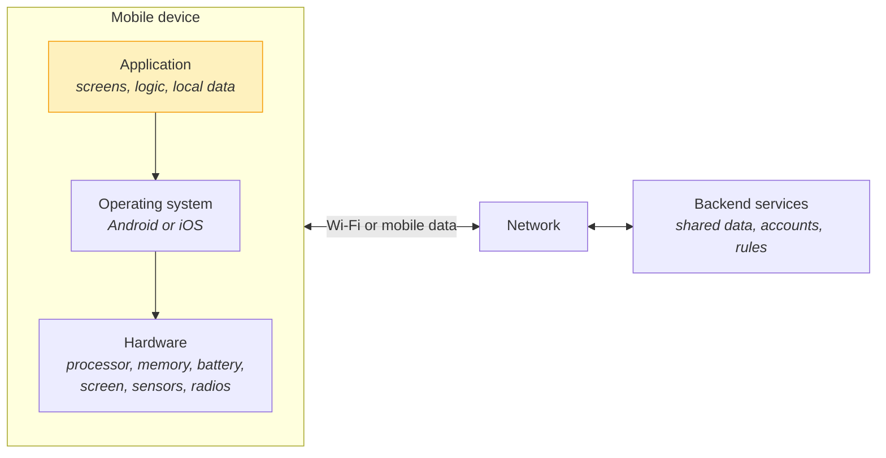
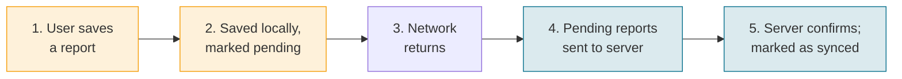
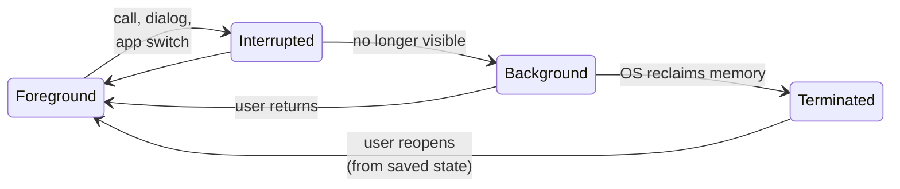
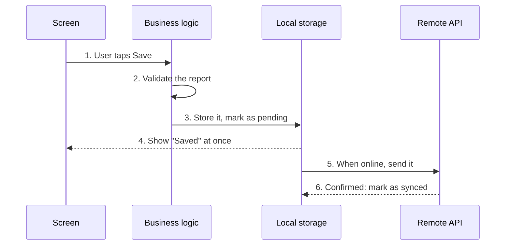
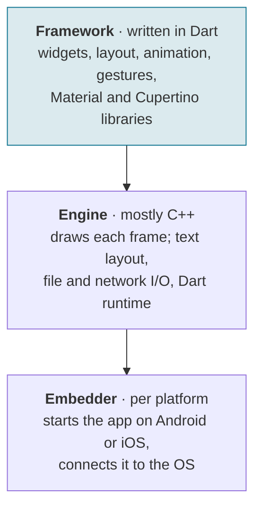
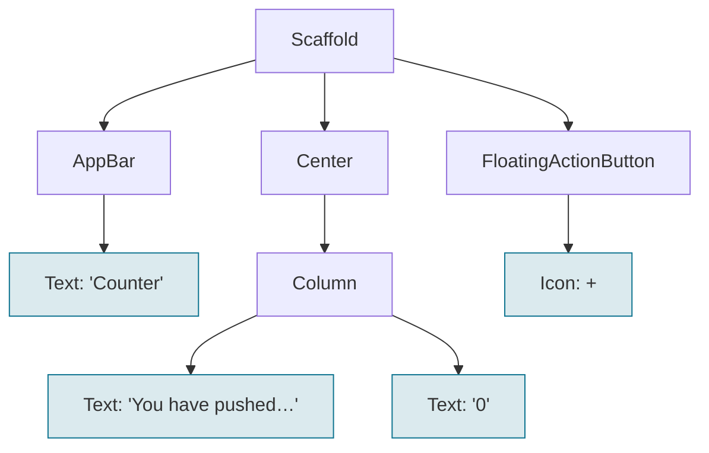
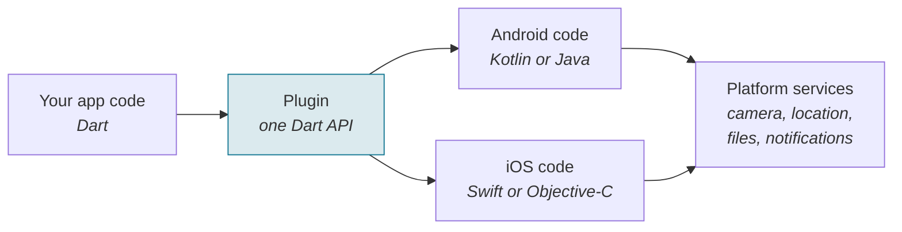

# Lecture 1: Mobile Systems and Multiplatform Development


<div class="lab-meta" markdown>
<div class="lab-meta__row"><span class="lab-meta__label">Course</span> Multiplatform Mobile Software Engineering in Practice</div>
<div class="lab-meta__row"><span class="lab-meta__label">Duration</span> 90 min</div>
<div class="lab-meta__row"><span class="lab-meta__label">Prerequisites</span> None. Lab 1 (terminal and Git) takes place earlier in the same meeting.</div>
</div>

<div class="grid cards" markdown>

- :material-target:{ .lg .middle } **Learning Outcomes**

    ---

    By the end of this lecture, you will be able to:

    - [ ] Describe the components and constraints of a mobile system
    - [ ] Explain why Android and iOS require platform-specific considerations
    - [ ] Distinguish native, shared-logic, shared-UI, hybrid and progressive web approaches
    - [ ] Explain the basic roles of Flutter, Dart, widgets, state and platform plugins
    - [ ] Discuss technology choices based on application requirements

- :material-clock-outline:{ .lg .middle } **Programme (90 min)**

    ---

    | Section | Duration |
    |---------|----------|
    | 1. Course introduction | 5 min |
    | 2. Characteristics of mobile systems | 15 min |
    | 3. Android and iOS | 10 min |
    | 4. Basic mobile application architecture | 10 min |
    | 5. Development approaches and technologies | 20 min |
    | 6. Introduction to Flutter | 15 min |
    | 7. Synthesis, discussion and closing | 15 min |

</div>

!!! info "The example used in this lecture"
    To make the ideas concrete, this lecture uses a **field-reporting app**: an inspector records problems on site, such as a cracked pavement or a broken streetlight, often where there is no signal. It is a thinking example only. The app you build in the labs is the **Mood Tracker**, which you start in Lab 3.


---

## 1. Course Introduction (5 min)

Most of you use a phone for hours every day. This lecture asks what is different about *building* software for it, and which technical approaches exist for building one app for several platforms. Flutter gets its own section, but only after we have the concepts that explain why it exists.

!!! question "Opening question (1 minute)"
    What makes a mobile application different from a desktop application? Note two differences, then compare with a neighbour.

    ??? success "Typical answers, grouped"
        - **Input:** touch instead of a mouse, a small screen
        - **Resources:** battery, memory, mobile data
        - **Context of use:** always with you; camera, GPS and other sensors
        - **Connectivity:** the network comes and goes
        - **Distribution:** app stores; interruptions by calls and notifications

        Every one of these returns in the next section.

---

## 2. Characteristics of Mobile Systems (15 min)

### A mobile system has five parts, and the app controls only one of them



- **Hardware:** processor, memory, storage, battery, screen, sensors (camera, GPS, accelerometer) and radios (Wi-Fi, mobile data, Bluetooth).
- **Operating system (OS):** the software that manages the hardware and runs apps. It decides when an app may run, how much memory it gets, which permissions it has, and how it reaches the camera or the network. Apps do not talk to the hardware directly; they ask the OS.
- **Application:** what we build: screens, logic and often local data. It runs inside the limits the OS sets.
- **Network:** Wi-Fi or mobile data. Its speed and availability change as the user moves.
- **Backend services:** servers that hold shared data, user accounts and business rules. The app reaches them through an **API**: an agreed set of requests, such as "give me the list of reports" or "save this report".

Our code is one part out of five. Many "mobile problems" are really consequences of the other four: a permission the OS denies, a slow connection, a low battery, a server that is not reachable.

### Phones are computers on a battery, so every resource has a limit

| Resource | What can go wrong |
|---|---|
| **Battery** | A map that keeps GPS on all the time drains the battery faster than one that asks for the location only when needed. |
| **Memory** | A gallery that loads every full-size photo at once can use up memory, and the OS may close the app without warning. |
| **Processor** | Resizing a large image while the user scrolls makes the screen stutter. Heavy work must not block the **main thread**, the part of the program that draws the screen and reacts to touch. |
| **Storage** | Cached maps, downloaded videos and offline data compete with the user's own photos for limited space. |
| **Data usage** | Uploading full-resolution photos over mobile data can cost the user money. Offer to sync on Wi-Fi only. |

!!! tip "Design rule"
    Do work only when it is needed, release what you do not use, and let the user control costly operations.

### Connections drop, so apps save data locally and synchronize later

An inspector saves a report in a basement with no signal. The app must not answer "no network, try later" and lose the work:



- **Latency** is the delay between a request and its response. A connection can be "up" but slow, so the interface must not freeze while it waits.
- **Local storage** keeps data on the device, for example in a small database, so the app can show content and accept input without a network.
- **Pending operations** wait in a queue. **Synchronization** sends them and merges newer data from the server. When the same record was edited in two places, a **conflict** must be resolved by a rule, such as "newest edit wins" or "ask the user".

Show local data first, synchronize in the background, and tell the user what is still pending. Offline support is a product decision: a live video call cannot work offline, and that is fine. The point is to decide deliberately.

### People use phones by touch, on many screens, in short interrupted sessions

- **Touch.** Fingers are less precise than a mouse and cannot hover. Targets must be large enough and well spaced; the Android and iOS design guidelines give minimum sizes.
- **Screen sizes.** From small phones to tablets and foldables. A fixed layout will break; layouts must adapt.
- **Orientation.** Rotating the device changes the available width and height, and the system may rebuild the screen. The app must not lose what the user typed.
- **Accessibility.** Screen readers, larger text, high contrast and captions are OS settings that apps must respect. A layout that cannot grow clips text when the user chooses a larger font.
- **Interrupted use.** Calls, notifications and app switches can interrupt at any moment. The app must keep the user's progress and resume.

### Sensors need permission, and the app must work when the user says no

Phones carry sensors that desktops usually lack: the **camera** (scan a code, photograph a defect), **location** (tag a report with where it was made) and **motion sensors** (detect rotation, steps or shakes). Because sensors expose personal data, the OS asks the user for **permission**. The dialog is shown by the OS, not by the app, and the user can allow, allow once or deny, and change the decision later in settings. Wording and options differ between platforms and OS versions.

When the user denies a permission:

1. Explain why the feature needs it, at the moment it is needed, not at app start.
2. Keep the app usable: offer manual entry of an address instead of GPS.
3. If the denial is permanent, point the user to system settings; do not keep asking.
4. Ask for the minimum: approximate location is often enough.

Collect the least data necessary, say what it is used for, and do not send it to a server without a reason.

---

## 3. Android and iOS (10 min)

### Android and iOS differ in tools, conventions, distribution and devices

| | Android | iOS |
|---|---|---|
| **Platform tools** | Android Studio; Kotlin (also Java); Jetpack Compose or XML views | Xcode on macOS; Swift; SwiftUI or UIKit |
| **Interface conventions** | Material Design; system back navigation | Apple Human Interface Guidelines; swipe-back and tab bars |
| **Distribution** | Google Play and other stores; direct installation is possible | App Store; rules differ by region and change over time |
| **Device diversity** | Many manufacturers, screen sizes and OS versions | Apple-made devices; fewer models, but versions still vary |

Same user goals, different rules: two toolchains, two design languages and two release processes. One practical consequence: building and publishing an iOS app requires Apple's tools, which run on macOS.

### The OS decides when an app runs, pauses or ends

Every mobile app moves through a **lifecycle** controlled by the operating system:



The four states are a teaching model that applies to any platform. Each platform exposes them through its own API. On Android, an **activity** (one screen) receives callbacks such as `onCreate`, `onStart`, `onResume`, `onPause`, `onStop` and `onDestroy`. The official documentation warns that the system can end the app's process without calling `onDestroy`, so important data must be saved earlier. iOS uses different states and callbacks.

The practical consequence: save important state early (for example a half-written report), and treat "returning to the app" as normal. A cross-platform framework must map its own lifecycle events onto both platforms.

### Devices and OS versions vary, so each target platform needs its own testing

- **OS versions:** older versions lack newer features and behave differently, and users do not all update.
- **Screen sizes:** small phones, large phones, tablets and foldables, in both orientations.
- **Hardware capabilities:** not every device has the same camera, sensors, memory or processor speed.
- **Accessibility settings:** larger text, screen readers and reduced motion change how screens look and behave.

!!! warning "One codebase does not mean one behaviour"
    With a cross-platform approach we share code, not the platforms. Permission dialogs, the keyboard, navigation gestures and the lifecycle remain platform behaviour, and plugins call different native code on each platform. A bug can appear on one platform only. Test on both platforms, on real devices as well as emulators, across several OS versions and screen sizes.

---

## 4. Basic Mobile Application Architecture (10 min)

### An app separates what the user sees, what it decides and where data lives

| Layer | Responsibility | Example in the field-reporting app |
|---|---|---|
| **Presentation** | Screens, buttons, forms. Shows data and passes user actions on. | The report form and the report list |
| **Business logic** | The rules of the application: what is allowed and what happens next. | A report needs a title and a photo before saving |
| **Data** | Reads and writes information, on the device or on a server. | A local database and the reports API |

Separating responsibilities makes each part easier to change, test and, later, to share between platforms. A common beginner mistake is to put validation or network calls directly in a button handler: it works at first, then makes the app hard to change and test.

### A user action can touch logic, local storage and a server in turn



- **Local first:** the user is not blocked by the network. The report is safe on the device from step 3.
- **Server later:** step 5 can wait for a connection. If it fails, the report stays pending and the app retries.
- **Which copy wins?** If both copies change, the app needs a rule. The server often holds the shared version.

If the app is killed between steps 3 and 5, the report is still in local storage with its pending mark, so the app can send it after the next start. This is the lifecycle from Section 3 at work.

### Logic is the easiest part to share; device integration is the hardest

| Potentially shared across platforms | Platform-specific |
|---|---|
| **Data models:** report, user, status | **Device integrations:** camera, location, notifications, biometrics |
| **Validation:** is the title present? | **Permissions and settings:** dialogs and rules differ per OS |
| **Networking:** API requests and responses | **Interface adaptations:** navigation gestures, system look and feel |
| **Storage abstractions:** save and load, without caring how | **Store packaging:** signing, release and store setup |

What is actually shared depends on the approach, which is the subject of the next section.

---

## 5. Development Approaches and Technologies (20 min)

### Native development builds a separate app per platform and sets the baseline

| | Android app | iOS app |
|---|---|---|
| Language | Kotlin | Swift |
| Tool | Android Studio | Xcode |
| UI toolkit | Jetpack Compose | SwiftUI |

Both UI toolkits are **declarative**: you describe what the screen should look like for a given state. Flutter uses the same idea.

- **Strengths:** direct access to every new platform feature; familiar look and behaviour on each platform; the best documentation and tooling from the platform vendors.
- **Costs:** two codebases and two skill sets; every feature is built and fixed twice; the two apps can drift apart.

Native is the **reference point**: every other approach ends up calling the same native platform APIs. It is a deliberate choice, not an outdated one.

### Approaches differ in which layers of the app they share

| Layer of the app | Shared logic | Shared UI | Native (baseline) |
|---|---|---|---|
| User interface | Per platform | **Shared** | Per platform |
| Business logic and data | **Shared** | **Shared** | Per platform |
| Platform integration | Per platform | Per platform | Per platform |

Platform integration stays platform-specific in every approach, even when a plugin hides it. Two further approaches, **hybrid apps** and **progressive web apps**, share almost everything because the common part is a web application; they are described below.

### Flutter shares one Dart codebase and draws the interface itself



- **One codebase in Dart.** Most app code, including the interface, is shared between Android and iOS.
- **Flutter draws its own interface.** Its engine paints the pixels instead of asking the OS to create platform buttons and lists. The interface can look the same on both platforms, but Flutter must imitate platform conventions itself.
- **Packaged like any other app.** To the operating system, a Flutter app looks like a normal Android or iOS app.
- **Platform access goes through plugins** (Section 6).

### React Native describes the interface in JavaScript and renders native views

Developers write JavaScript or TypeScript and describe the interface with React components. At run time, React Native creates the corresponding platform views, so controls follow each platform's own look and behaviour:

| Component | Android view | iOS view |
|---|---|---|
| `View` | `ViewGroup` | `UIView` |
| `Image` | `ImageView` | `UIImageView` |
| `TextInput` | `EditText` | `UITextField` |

Both Flutter and React Native can share most of the UI code, but differently: React Native asks the platform to create native views; Flutter paints its own pixels. React Native's internal architecture has changed over time, so check the current official documentation rather than older descriptions of its internals.

### Kotlin Multiplatform shares logic first and can share the interface as well

**Kotlin Multiplatform (KMP)** shares Kotlin code such as business rules, data models and networking. It does not replace the native UI unless you want it to. **Compose Multiplatform** is an optional UI framework built on KMP that shares screens too, in the declarative style of Jetpack Compose.

- **Option A: share logic, keep native UI.** A shared Kotlin module; Jetpack Compose on Android, SwiftUI or UIKit on iOS.
- **Option B: share logic and UI** with Compose Multiplatform.

Teams can adopt it gradually, sharing one module first. According to JetBrains (checked October 2026), KMP is stable; Compose Multiplatform is stable for Android, iOS and desktop, with web support in Beta.

### Hybrid apps run a web app inside a native shell

The interface is a web application (HTML, CSS, JavaScript), packaged into a native shell and shown in a **WebView**, a browser component inside the app. Two tools are often confused:

- **Ionic Framework** is a set of UI components for web apps that look and behave like mobile controls.
- **Capacitor** is a native runtime: it loads the web app, provides a bridge from JavaScript to native code, and offers **plugins** for the camera, geolocation or filesystem. It works with any web framework, not only Ionic.

One web codebase can serve iOS, Android and the web. Because the interface is web-rendered, platform-native controls are not used by default, and heavy graphics or very platform-specific behaviour need extra care.

### Progressive web apps reach users through the browser

A **progressive web app (PWA)** is a website with app-like capabilities. Users open a link, use it in the browser and, where supported, install it so that it launches from the home screen in its own window. No store is needed. Its building blocks:

- **HTTPS**, a secure connection, required for PWA features;
- a **web app manifest**, a JSON file with the name, icons and display mode;
- a **service worker**, a script that can cache files and data. Offline use exists only if you implement it.

Support differs between browsers and operating systems, notably on iOS, and device access is limited to what browsers expose. Test on the real browsers and devices you target.

### Each approach trades code sharing against platform access and control

| Approach | Main languages | Code sharing | UI approach | Device access | Key trade-off |
|---|---|---|---|---|---|
| **Native** | Kotlin; Swift | None: two apps | Platform toolkits | Full and direct | Most control, most effort |
| **Kotlin Multiplatform** | Kotlin | Logic; UI optional | Native UI or Compose Multiplatform | Direct, via Kotlin | Flexible; needs Kotlin skills |
| **Flutter** | Dart | Logic and UI | Own widgets, own rendering | Plugins and native code | Consistent UI; own ecosystem |
| **React Native** | JavaScript, TypeScript | Logic and UI | Native views from components | Libraries, native modules | Web skills reused; shifting ecosystem |
| **Hybrid** (Ionic + Capacitor) | HTML, CSS, JavaScript | Nearly all | Web UI in a WebView | Capacitor plugins | Web reuse; web-style UI |
| **Progressive web app** | HTML, CSS, JavaScript | One web app | Rendered by the browser | Browser APIs only | No store; uneven device access |

This is a qualitative comparison based on each technology's official documentation, not a ranking. "Can be shared" is not "will be shared": every row still needs testing on each platform.

---

## 6. Introduction to Flutter (15 min)

### Flutter is the toolkit and Dart is the language you write it in

- **The Flutter SDK** is the toolkit: a library of widgets, the engine that draws the interface, command-line tools to create, run, test and build apps, and access to packages and plugins.
- **Dart** is the language: typed, object-oriented, with a C-style syntax that will feel familiar if you know Java, C# or JavaScript. During development, Dart runs in a virtual machine that enables hot reload; release builds are compiled to machine code.

Compare: Android has Kotlin plus the Android SDK; Flutter has Dart plus the Flutter SDK. Flutter also targets the web and desktop; this course concentrates on Android and iOS. You do not need prior Dart knowledge: Lab 2 and Lecture 2 cover it.

### Flutter interfaces are trees of widgets that describe the screen



- **Everything is a widget:** text, buttons, padding and whole screens. Layout elements such as `Center` and `Column` are widgets too.
- **Widgets are composed:** small widgets nest inside larger ones.
- **The UI is declarative:** you describe the screen for the current state. The Flutter documentation summarises this as **UI = f(state)**. Jetpack Compose, SwiftUI and React work the same way.

### A user event changes state, and Flutter rebuilds the interface from it

**State** is data that can change while the app runs and that affects what the screen shows. In the counter app, it is one integer:

```dart
class _CounterPageState extends State<CounterPage> {
  int _counter = 0; // state

  void _incrementCounter() {
    setState(() {
      _counter++; // change the state
    }); // ask Flutter to rebuild
  }

  @override
  Widget build(BuildContext context) {
    // ...
    // Text('$_counter') shows the state
    // onPressed: _incrementCounter runs on every tap
  }
}
```

1. **Event:** the user taps the **+** button, which calls `_incrementCounter`.
2. **State changes:** `setState` updates `_counter` and tells Flutter that the state changed.
3. **UI updates:** Flutter calls `build()` again, and the `Text` shows the new number.

If you change `_counter` without `setState`, the value changes in memory but the screen does not. `setState` suits short-lived state inside one widget; apps that share state across screens use other approaches, covered later.

??? example "The complete counter app"
    ```dart
    import 'package:flutter/material.dart';

    void main() {
      runApp(const MyApp());
    }

    class MyApp extends StatelessWidget {
      const MyApp({super.key});

      @override
      Widget build(BuildContext context) {
        return MaterialApp(
          title: 'Counter',
          theme: ThemeData(colorScheme: ColorScheme.fromSeed(seedColor: Colors.teal)),
          home: const CounterPage(),
        );
      }
    }

    class CounterPage extends StatefulWidget {
      const CounterPage({super.key});

      @override
      State<CounterPage> createState() => _CounterPageState();
    }

    class _CounterPageState extends State<CounterPage> {
      int _counter = 0; // state

      void _incrementCounter() {
        setState(() {
          _counter++; // change the state
        }); // ask Flutter to rebuild
      }

      @override
      Widget build(BuildContext context) {
        return Scaffold(
          appBar: AppBar(title: const Text('Counter')),
          body: Center(
            child: Column(
              mainAxisAlignment: MainAxisAlignment.center,
              children: [
                const Text('You have pushed the button this many times:'),
                Text('$_counter', style: Theme.of(context).textTheme.headlineMedium),
              ],
            ),
          ),
          floatingActionButton: FloatingActionButton(
            onPressed: _incrementCounter,
            tooltip: 'Increment',
            child: const Icon(Icons.add),
          ),
        );
      }
    }
    ```

    Checked with Flutter 3.35.4 / Dart 3.9.2: `flutter analyze` reports no issues, and a widget test confirms that a tap changes the counter from 0 to 1.

### Hot reload applies code changes to a running app without losing its state

You develop in an **editor** (VS Code or Android Studio, with the Flutter and Dart extensions) and run the app on a **run target**: an Android emulator, the iOS Simulator (macOS only) or a physical phone. Emulators are convenient for quick checks; a real device is needed for sensors, the camera and true performance.

- **Hot reload** loads your edited code into the running app and keeps its state: the counter stays where it was.
- **Hot restart** starts the app again from the beginning and resets the state: the counter goes back to 0.

Hot reload and hot restart work only in debug mode. Most code changes can be hot reloaded; some, such as a new starting value for state, need a hot restart.

!!! example "Live demonstration (4 min)"
    1. Run the counter app: it shows 0.
    2. Tap **+** three times.
    3. Change the app bar title to *Field counter* and its colour.
    4. Hot reload: the new look appears, and the counter keeps its value. Then hot restart: the counter resets to 0.

    You will repeat this yourself in Lab 3.


### Plugins connect shared Dart code to camera, location and other platform services



A **package** is a reusable library published on [pub.dev](https://pub.dev) and added to a project as a dependency. A **plugin** is a package that makes platform functionality available to the app, with one implementation per platform behind a single Dart API. Dart and native code communicate through **platform channels**. If no plugin exists, you can write platform code yourself.

A plugin does not remove platform setup. On Android the needed permissions are declared in the app's manifest; on iOS the app's configuration must explain why it needs the camera or location. At run time the OS still shows its permission dialog, and the app must handle a denial. Before using a package, check that it is maintained, supports your target platforms and has a suitable licence.

---

## 7. Synthesis, Discussion and Closing (15 min)

### Technology choice follows from six questions about the app and the team

| # | Factor | Question |
|---|---|---|
| 1 | **Device access** | Which sensors and platform features does the app need, and how deeply? |
| 2 | **Look and behaviour** | Must it feel exactly like a platform app, or is one consistent design acceptable? |
| 3 | **Team skills** | Does the team know Kotlin, Swift, Dart, JavaScript or web development? |
| 4 | **Existing code** | Is there a native app, a web app or a backend that should be reused? |
| 5 | **Offline and data** | How much must work without a connection, and how is data synchronized? |
| 6 | **Delivery and upkeep** | How fast must the first version ship, and who maintains it for years? |

No approach wins on every factor. Rank the factors for your app first, then read the comparison table against that ranking.

### Scenarios: choose an approach and justify it

!!! question "Group work (3 minutes, groups of three)"
    Choose one scenario. Name an approach, give **two reasons** and **one risk**.

    | Scenario | Key facts | Question for your group |
    |---|---|---|
    | **A. Field reports** | Camera and GPS, must work offline, team of three, both platforms | Which approach, and what would you test first? |
    | **B. Bank app** | Existing native Android and iOS teams, strict platform look, shared rules wanted | What could be shared, and what stays native? |
    | **C. Event guide** | Mostly content, needed in two weeks, small web team, no deep device access | Is an installed app necessary at all? |
    | **D. Camera effects** | Real-time image processing, heavy use of the processor and graphics | Which factors push toward native code? |

    ??? success "Points to consider after the discussion"
        There is no single correct answer; the quality of the reasons matters.

        - **A:** a shared-UI approach such as Flutter or React Native (one codebase, plugins for camera and location), or Kotlin Multiplatform for a Kotlin team. Risks: plugin gaps, offline synchronization bugs, platform differences found late. Test first: offline save and sync, permission denial, the camera on real devices of both platforms.
        - **B:** share logic (for example with Kotlin Multiplatform) and keep native screens, or stay fully native with shared specifications and tests.
        - **C:** a progressive web app or a hybrid app reuses web skills and may not need a store listing. Risks: uneven browser support for installation and notifications.
        - **D:** direct access to platform graphics and camera APIs is valuable, so native code is the lower-risk starting point. Cross-platform tools can call native code, but the effort and risk grow. A prototype on real devices settles the question.

### Four common beliefs about cross-platform development need correcting

| Common belief | What holds |
|---|---|
| Cross-platform means no native knowledge is needed. | You still meet Android and iOS rules: permissions, lifecycle, store setup and plugin configuration. |
| One codebase means one behaviour on every device. | Shared code runs on different OS versions, screens and plugins, so each platform needs testing. |
| One approach is best for every app. | The right choice depends on device access, team skills, existing code and delivery needs. |
| Native development is outdated. | It remains the reference point, and a sound choice when platform features or platform feel come first. |

### Summary: what you can now do

| Outcome | Key points |
|---|---|
| Components and constraints | Device, OS, app, network and backend; battery, memory, processing, storage, data, connectivity |
| Android and iOS | Different tools, conventions, distribution, lifecycle and device diversity |
| Five approaches | Native, shared logic, shared UI, hybrid and progressive web app |
| Flutter basics | Dart, the widget tree, state and `setState`, hot reload, plugins |
| Technology choice | Six questions: device access, look, skills, existing code, offline data, delivery |

Back to the opening question: a mobile application differs from a desktop one through **resource limits**, **touch and varied screens**, **unreliable networks**, an **OS-controlled lifecycle**, and **sensors with permissions**.

---

## Quick Quiz

<quiz>
An app keeps working while the user is underground and sends the data later. Which idea does this describe?

- [ ] Hot reload
- [x] Local storage with pending operations and synchronization
- [ ] A progressive web app's manifest
- [ ] The Android activity lifecycle

---

**Local first, server later.** The data is stored on the device and marked as pending, then synchronized when the network returns.
</quiz>

<quiz>
Why should an Android app not rely on `onDestroy` to save the user's work?

- [ ] `onDestroy` runs before `onCreate`
- [x] The system can end the app's process without calling `onDestroy`
- [ ] `onDestroy` exists only on iOS
- [ ] Saving data is not allowed in lifecycle callbacks
</quiz>

<quiz>
What is the main difference between how Flutter and React Native produce the interface?

- [ ] Flutter shares only logic; React Native shares only the UI
- [x] Flutter draws its own pixels; React Native creates native platform views from shared components
- [ ] React Native compiles to Dart
- [ ] There is no difference
</quiz>

<quiz>
You change `_counter++` but forget `setState`. What does the user see?

- [ ] The app crashes
- [ ] The new value immediately
- [x] The old value: the data changed in memory, but Flutter was not asked to rebuild
- [ ] A permission dialog
</quiz>

<quiz>
A Flutter app uses a camera plugin. Which statement is true?

- [ ] The plugin removes all platform setup
- [ ] The camera then works the same way on every device without testing
- [x] Platform configuration and the OS permission dialog are still needed, and each platform needs testing
- [ ] Plugins only work on Android
</quiz>

---

## Glossary

| Term | Meaning |
|---|---|
| **API** | A defined set of requests an app can send to a server or a library |
| **Backend** | Servers that hold shared data, accounts and business rules |
| **Declarative UI** | Code describes what the screen looks like for the current state |
| **Emulator / simulator** | A virtual phone on a computer: the Android emulator, the iOS Simulator |
| **Hot reload** | Applies code edits to a running debug app and keeps its state |
| **Lifecycle** | The states an app moves through: foreground, background, terminated |
| **Permission** | The user's consent to use a sensor or sensitive data |
| **Plugin** | A package that gives app code access to platform features |
| **State** | Data that can change while the app runs and affects the screen |
| **Synchronization** | Bringing local and server data to the same state |
| **WebView** | A browser component embedded inside a native app |
| **Widget** | A building block of a Flutter interface; widgets form a tree |

---

## In This Meeting and Next

- **Before this lecture:** Lab 1 (terminal, Git and GitHub).
- **Next meeting:** Lab 2 (Dart fundamentals), then Lecture 2 (Dart, widgets and layout), where you start reading and writing Flutter code.

## Sources

Checked in October 2026. Versions, support status and store rules change; re-check before relying on them.

- [Android Developers: The activity lifecycle](https://developer.android.com/guide/components/activities/activity-lifecycle)
- [Flutter: Architectural overview](https://docs.flutter.dev/resources/architectural-overview)
- [Flutter: State management](https://docs.flutter.dev/data-and-backend/state-mgmt)
- [Flutter: Hot reload](https://docs.flutter.dev/tools/hot-reload)
- [Flutter: Using packages](https://docs.flutter.dev/packages-and-plugins/using-packages)
- [React Native: Core Components and Native Components](https://reactnative.dev/docs/intro-react-native-components)
- [Kotlin Multiplatform](https://kotlinlang.org/multiplatform/) and its [FAQ](https://kotlinlang.org/docs/multiplatform/faq.html)
- [Capacitor documentation](https://capacitorjs.com/docs)
- [Learn PWA](https://web.dev/learn/pwa) and [MDN: Progressive web apps](https://developer.mozilla.org/en-US/docs/Web/Progressive_web_apps)
