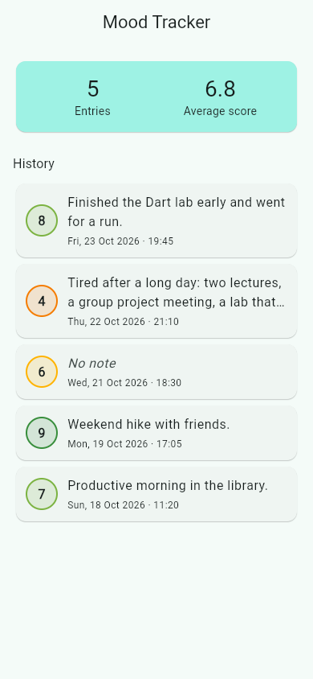
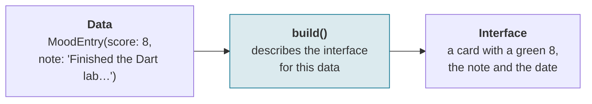
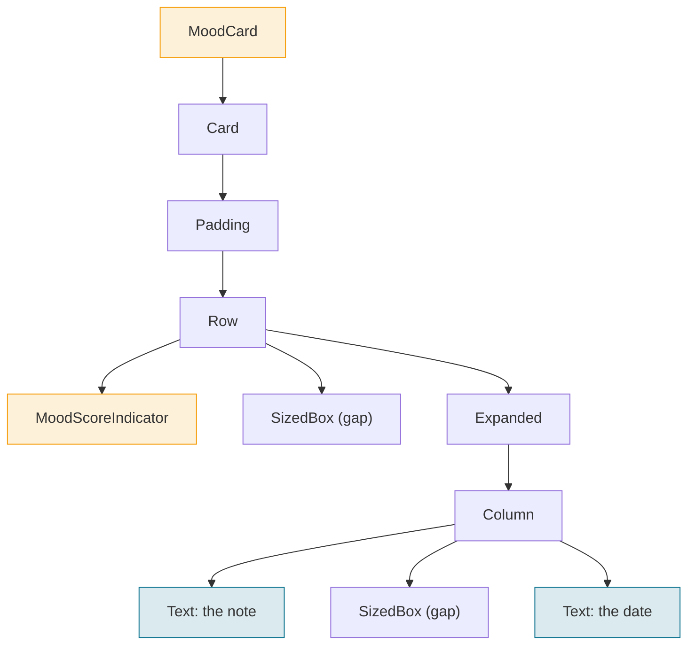
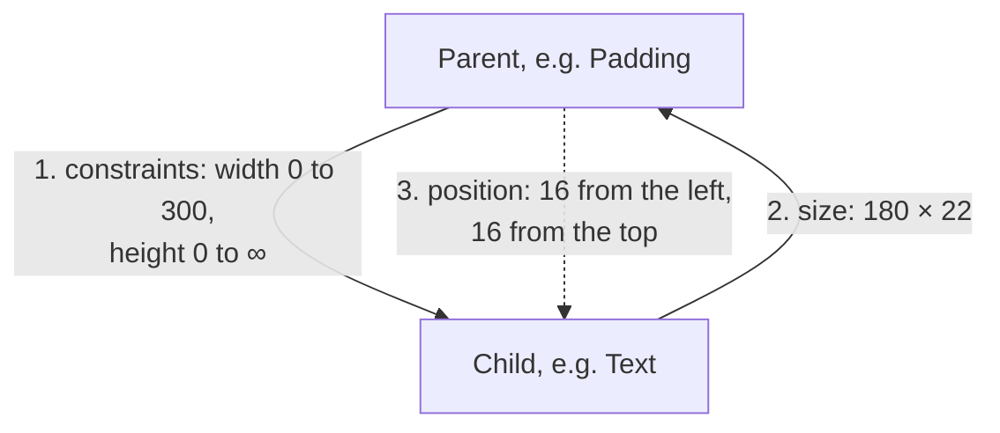
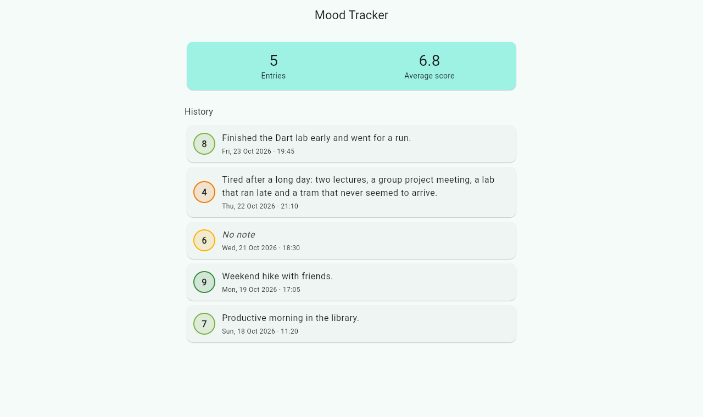

# Lecture 2: Building a Flutter Application: Dart, Widgets and Layout


<div class="lab-meta" markdown>
<div class="lab-meta__row"><span class="lab-meta__label">Course</span> Multiplatform Mobile Software Engineering in Practice</div>
<div class="lab-meta__row"><span class="lab-meta__label">Duration</span> 90 min</div>
<div class="lab-meta__row"><span class="lab-meta__label">Prerequisites</span> Lecture 1; Lab 2 (Dart fundamentals) earlier in this meeting</div>
</div>

<div class="grid cards" markdown>

- :material-target:{ .lg .middle } **Learning Outcomes**

    ---

    By the end of this lecture, you will be able to:

    - [ ] Explain the roles of Dart, Flutter and the main project files
    - [ ] Read basic Dart code used in Flutter apps
    - [ ] Build a screen by composing widgets
    - [ ] Pass data into reusable widgets
    - [ ] Explain layout constraints and fix simple overflow

- :material-clock-outline:{ .lg .middle } **Programme (90 min)**

    ---

    | Section | Duration |
    |---------|----------|
    | 1. Recap and goals | 5 min |
    | 2. Dart essentials | 20 min |
    | 3. Anatomy of a Flutter project | 10 min |
    | 4. Widgets and declarative UI | 15 min |
    | 5. Layout and constraints | 20 min |
    | 6. Worked example: the Mood Tracker home screen | 15 min |
    | 7. Recap and comprehension check | 5 min |

</div>


---

## 1. Recap and Goals (5 min)

Lecture 1 explained what a mobile system is and why several approaches to multiplatform development exist. Two of its ideas carry straight into today:

- **Flutter** is a UI toolkit (widgets, a rendering engine and tools); **Dart** is the language Flutter apps are written in.
- **Shared code** describes the interface once for Android and iOS, but **platform care** is still needed: permissions, the lifecycle and testing differ per platform.

Today we start building. By the end of the lecture you will understand every line of this screen: the first screen of the **Mood Tracker**, the app you build in the labs.

<figure markdown>
{ width="300" }
<figcaption>Today's screen: a summary and a history of mood entries. Screenshot of Checkpoint 01, running in a browser.</figcaption>
</figure>

Each entry has a **score** from 1 to 10 in a coloured circle, an optional **note** and the **date** it was recorded. The data is invented and written directly in the code: there is no saving, network or interaction yet. Notice the second note: it is too long for the card, yet it is cut neatly instead of breaking the layout. By the end of Section 5 you will know why.

---

## 2. Dart Essentials (20 min)

You practised these features in Lab 2. Here we focus on the ones that Flutter code uses constantly.

### Every Dart value has a type, written out or inferred

```dart
String note = 'Finished the Dart lab early';
int score = 8;
bool hasNote = true;

var place = 'Library'; // Dart infers: String
// place = 42;         // compile error: an int is not a String
```

A **type** says what kind of value a variable holds. `var` lets Dart work out the type from the first value, but the type is still fixed. The compiler checks types before the app runs, so many mistakes appear in the editor straight away.

!!! warning "Common misconception"
    `var` does not mean "can hold anything", as in JavaScript. That is `dynamic`, which beginners should avoid.

### `final` fixes a variable once; `const` fixes a value at compile time

```dart
final createdAt = DateTime.now(); // set once, when the program runs
final notes = <String>['Run'];
notes.add('Library');             // OK: the list itself can change
// notes = [];                    // compile error: notes is final

const maxScore = 10;              // known before the program runs
const bands = ['Low', 'High'];
// bands.add('Medium');           // compiles, but fails at run time
// const now = DateTime.now();    // compile error: not a compile-time value
```

- **`final` protects the name, not the contents.** A `final` list can still change; only pointing the variable at another object is forbidden.
- **`const` values are deeply constant.** They must be known before the app runs and cannot be modified.
- **In Flutter:** model fields are usually `final`. Widgets with fixed content can be `const`, so Flutter can reuse them instead of rebuilding them.

### Null safety makes missing values explicit in the type

A mood entry may have no note:

```dart
String? note;                       // String? may be null; String may not

// print(note.length);              // compile error: note may be null
print(note?.length);                // null-aware access: null if there is no note
String shown = note ?? 'No note';   // if-null: use a default
if (note != null) print(note.length); // inside the if, note is a String
```

**Null** means "no value". In Dart a type cannot hold `null` unless it ends with `?`, and the compiler makes you handle that case. Avoid `note!`: it tells Dart "trust me" and crashes at run time if the value is `null`.

`note ?? 'No note'` is exactly what the Mood Tracker uses to show an entry without a note.

### Functions can be passed as values, and named parameters label each argument

```dart
String label(int score) => score >= 7 ? 'Good day' : 'Tough day';

void describe({required int score, String note = 'No note'}) {
  print('$score: $note');
}

describe(score: 7);      // named argument; note uses its default

void onSave() => print('Saved');
// ElevatedButton(onPressed: onSave, child: const Text('Save'))
// onPressed: () { print('Saved'); }   // the same idea, written inline
```

- **Named parameters** go in `{ }`. Callers write the name (`score: 7`), order does not matter, and `required` makes one compulsory.
- **Callbacks:** functions are values, so `onPressed: onSave` passes the function itself, for the button to call later.

!!! warning "Common mistake"
    `onPressed: onSave()` (with parentheses) calls the function immediately, while the screen is being built, and passes its result instead of the function.

Every widget constructor uses named parameters (`child:`, `padding:`, `onPressed:`), and events are handled by passing callbacks.

### A class groups fields, and its constructor fills them once

```dart
class Student {
  const Student({required this.name, required this.group});

  final String name;   // field
  final String group;
}

final ana = Student(name: 'Ana', group: '3B');
print(ana.name); // Ana
```

`this.name` copies the argument into the field. Because all fields are `final`, the object never changes after it is created; to "change" it, you create a new one. Such **immutable** objects are safe to share between widgets and fit Flutter's rebuild model well.

### Lists hold ordered items; maps look up values by key

```dart
List<int> scores = [8, 4, 6];
print(scores[0]);           // 8 (indices start at 0)

Map<String, int> lastWeek = {'Mon': 7, 'Tue': 5};
print(lastWeek['Mon']);     // 7; the result type is int?, because the key may be missing

scores.add(9);
for (final s in scores) {
  print(s);
}
final total = scores.fold(0, (sum, s) => sum + s); // 27; optional syntax
```

`Row` and `Column` take a list of widgets as `children`, and the Mood Tracker keeps its entries in a `List<MoodEntry>`.

### The `MoodEntry` model combines types, final fields and null safety

This is the model used for the rest of the lecture and in the labs (`lib/models/mood_entry.dart`):

```dart
/// A single mood log entry.
///
/// The class is immutable: every field is `final`. To change an entry, create
/// a new one.
class MoodEntry {
  const MoodEntry({
    required this.score,
    required this.createdAt,
    this.note,
  }) : assert(score >= 1 && score <= 10, 'score must be between 1 and 10');

  /// Mood score from 1 (worst) to 10 (best).
  final int score;

  /// Optional free-text note. `null` means the user wrote nothing.
  final String? note;

  /// When the entry was recorded.
  final DateTime createdAt;
}

/// The average score of [entries], or `null` when there are no entries.
double? averageScore(List<MoodEntry> entries) {
  if (entries.isEmpty) return null;
  final total = entries.fold<int>(0, (sum, entry) => sum + entry.score);
  return total / entries.length;
}
```

- **Required named parameters** for the score and the date; the **note** is optional and nullable.
- **`assert`** checks the 1–10 range while you develop: in a debug build, `MoodEntry(score: 11, …)` throws an error with a clear message. Release builds skip asserts.
- **`averageScore` returns `double?`**: with no entries there is no average, and `0.0` would look like a real, very bad score.

This is the same class you wrote for assignment A2, now with the field names used by the Flutter app.

??? note "Optional: enums"
    When a value can only be one of a fixed set, Dart offers an **enum**, and the compiler rejects typos:

    ```dart
    enum Trend { rising, steady, falling }

    final t = Trend.rising;
    // Trend.risng; // compile error
    ```

    An enum value can also carry data, such as a label to show on screen. See the [Dart enums documentation](https://dart.dev/language/enums).

---

## 3. Anatomy of a Flutter Project (10 min)

### A Flutter project separates shared Dart code from platform host projects

```
mood_tracker/
├── lib/                 # your Dart code (the same on every platform)
│   ├── main.dart
│   ├── models/          # MoodEntry
│   ├── data/            # sample entries
│   ├── widgets/         # MoodScoreIndicator, MoodCard, MoodSummary
│   └── screens/         # HomeScreen
├── test/                # automated tests
├── pubspec.yaml         # name, dependencies, assets
├── analysis_options.yaml
├── android/             # Android host project
└── ios/                 # iOS host project (Xcode)
```

- **`lib/`** holds all application Dart code. Folders such as `models/` and `widgets/` are a common convention, not a rule enforced by Flutter.
- **Platform folders** (`android/`, `ios/`, and `web/`, `macos/`, `windows/`, `linux/` if those targets are configured) are native host projects. You edit them for platform settings: the app name and icon, permissions, the minimum OS version, signing. `flutter create --platforms=android,ios .` generates them.
- Generated items you can ignore for now: `.dart_tool/` and `build/` (do not edit or commit them) and `pubspec.lock` (the exact versions resolved).

### `pubspec.yaml` declares the project's packages and bundled assets

```yaml
name: mood_tracker              # used in imports: package:mood_tracker/...
publish_to: 'none'
version: 1.0.0+1

environment:
  sdk: ^3.9.0                   # Dart SDK versions the project accepts

dependencies:
  flutter:
    sdk: flutter
  intl: ^0.20.2                 # date formatting; added with: flutter pub add intl

dev_dependencies:
  flutter_test:
    sdk: flutter
  flutter_lints: ^5.0.0

flutter:
  uses-material-design: true    # bundles the Material icon font
```

YAML expresses structure through indentation with spaces, and wrong indentation is the most common way to break this file. `flutter pub add <name>` adds a package from [pub.dev](https://pub.dev) and fetches it. Images and other files you want to bundle are listed under `flutter: assets:`; the Mood Tracker needs none yet.

### `main()` calls `runApp()` with the root widget, and Flutter takes over

```dart
import 'package:flutter/material.dart';

import 'data/sample_entries.dart';
import 'screens/home_screen.dart';

void main() {
  runApp(const MoodTrackerApp());
}

class MoodTrackerApp extends StatelessWidget {
  const MoodTrackerApp({super.key});

  @override
  Widget build(BuildContext context) {
    return MaterialApp(
      title: 'Mood Tracker',
      theme: ThemeData(colorSchemeSeed: Colors.teal),
      home: HomeScreen(entries: sampleEntries),
    );
  }
}
```

1. **`main()`:** Dart starts every program here.
2. **`runApp()`:** makes the given widget the root of the widget tree.
3. **The root widget:** `MoodTrackerApp` sets the title, the theme and the first screen.
4. **Run it** with `flutter run`, or the Run button in the editor, on an emulator, a simulator, a phone, or a desktop or browser window.

`main.dart` is only the entry point; screens are widgets, usually in other files. Remember from Lecture 1: edits to `build()` appear with hot reload and keep the state; changes to `main()` or to startup values need a hot restart.

---

## 4. Widgets and Declarative UI (15 min)

### Flutter code describes the interface for given data



**UI = f(state):** the screen is a function of the data. You describe the result, and Flutter works out what to change on screen. An imperative toolkit would say "find the label, set its text, change its colour"; declarative code never edits the screen directly. To show different data, you change the data and Flutter calls `build()` again.

### A screen is a tree of small widgets nested inside each other

One history item, `MoodCard`, is this tree:



`Card` draws the rounded box, `Padding` adds space inside it, the `Row` puts the score circle beside the text, and the `Column` stacks the note above the date. There is no separate layout file: layout widgets such as `Padding`, `Row` and `Column` are widgets too, in the same tree as the visible ones. Orange boxes are the Mood Tracker's own widgets; green boxes draw something you can see.

### `build()` returns a description and must not change anything

```dart
// Good: build() only describes
@override
Widget build(BuildContext context) {
  return Text(entry.note ?? 'No note');
}

// Avoid: side effects inside build()
@override
Widget build(BuildContext context) {
  sendToServer(entry); // no!
  counter++;           // no!
  return Text(entry.note ?? 'No note');
}
```

Flutter, not you, calls `build()`: when the widget first appears, and again whenever its inputs or dependencies change, such as the theme or the screen size. That can happen many times, so `build()` must be fast and free of **side effects**: no network calls, no file writes, no changing data. Such actions belong in event handlers and lifecycle methods.

### Data enters a widget through its constructor

```dart
class MoodCard extends StatelessWidget {
  const MoodCard({super.key, required this.entry});

  final MoodEntry entry;

  @override
  Widget build(BuildContext context) {
    return Text(entry.note ?? 'No note'); // simplified; the full version is in Section 6
  }
}

// Using it: pass an entry in
MoodCard(entry: sampleEntries[0])
```

The same widget shows any entry; only the argument differs. The card does not know where the entry came from: invented sample data today, a server in a later lab. Putting the sample data inside `MoodCard` would make it able to show only one entry. Data flows from the parent down into the child.

### Stateless widgets depend on inputs; stateful widgets also keep changing data

| `StatelessWidget` | `StatefulWidget` |
|---|---|
| All data comes from outside: the constructor, the theme | Owns data that changes while it is on screen, kept in a separate `State` object |
| Still rebuilds when its parent passes new inputs or the theme or screen size changes | Calls `setState()` to ask for a rebuild |
| Today: `MoodScoreIndicator`, `MoodCard`, `MoodSummary`, `HomeScreen` | Lab 4 and Lecture 4: a score selector and an entry form |

**Stateless does not mean "never rebuilds".** Start stateless, and make a widget stateful only when it must remember something that changes while it is visible. You saw the stateful shape in Lecture 1's counter app.

---

## 5. Layout and Constraints (20 min)

### Parents pass constraints down, children choose sizes, parents position them

The official Flutter documentation asks you to memorise one rule:

!!! abstract "The layout rule"
    **Constraints go down. Sizes go up. Parent sets position.**



A **constraint** is a minimum and maximum width and height. A widget cannot choose a size outside its constraints, and it does not know its own position. Most layout surprises come from forgetting which constraints a parent passed down. (Unlike HTML and CSS, where children push parents to grow, Flutter is parent-driven.)

### `Row` arranges widgets horizontally; `Column` arranges them vertically

```dart
Row(children: [
  MoodScoreIndicator(score: 8),
  const SizedBox(width: 12),
  const Text('Weekend hike with friends.'),
])

Column(
  crossAxisAlignment: CrossAxisAlignment.start,
  children: [
    Text('Weekend hike with friends.'),
    Text('Mon, 19 Oct 2026 · 17:05'),
  ],
)
```

The **main axis** is the direction of the children (horizontal for `Row`, vertical for `Column`); the **cross axis** is the other one. `mainAxisAlignment` distributes children along the main axis; `crossAxisAlignment` aligns them across it. Without `CrossAxisAlignment.start`, a `Column` centres its children. A `Row` never wraps onto a new line; use `Wrap` for that. The plain `Row` above works for a short note, but a long note or a very narrow screen makes it overflow; the end of this section shows why, and how to fix it.

### Padding and spacing turn a block of text into a readable component

`Padding(padding: EdgeInsets.all(12), child: …)` adds 12 logical pixels on every side; `EdgeInsets.symmetric(...)` and `EdgeInsets.only(...)` are other forms. `SizedBox(height: 4)` inserts a fixed gap. In constraint terms, a `Padding` passes smaller constraints to its child (12 less on each side) and then positions it. Use `Padding` and `SizedBox` instead of spaces in strings or empty `Text` widgets: they express intent.

### `Expanded` gives a `Row`'s remaining width to one child

```dart
Row(children: [
  MoodScoreIndicator(score: entry.score),
  const SizedBox(width: 12),
  Expanded(
    child: Column(/* note and date */),
  ),
])
```

1. The `Row` lays out its non-flexible children first, at their natural size: the circle and the gap.
2. The leftover width goes to `Expanded`.
3. The `Column` inside gets a **bounded** width, so its `Text` can wrap.

| | |
|---|---|
| **`Expanded`** | The child must fill its share of the space (tight fit) |
| **`Flexible`** | The child may use up to its share, and can be smaller (loose fit) |
| **`flex: 2`** | A child with flex 2 gets twice the share of a child with flex 1 |

**Where they can go:** `Expanded` and `Flexible` must sit under a `Row`, `Column` or `Flex`. Your own stateless or stateful wrapper widgets may sit in between, but layout widgets such as `Padding`, `Center` or `SizedBox` may not. The beginner pattern is to put the padding *inside* the `Expanded`:

```dart
Row(children: [
  Expanded(
    child: Padding(
      padding: const EdgeInsets.all(8),
      child: Text(entry.note ?? 'No note'),
    ),
  ),
])
```

`Row > Padding > Expanded` is wrong, and so is an `Expanded` inside a `ListView`. Either produces the error *"Incorrect use of ParentDataWidget"*: read it as "Expanded is in the wrong place".

### Safe areas keep content away from system intrusions

The status bar, camera cutouts, rounded corners and the gesture bar take space from the screen, and the app window may extend under them. `SafeArea` adds just enough padding to keep its child visible and tappable. A `Scaffold`'s `AppBar` already handles the top; the bottom and the sides may still need it. Never hard-code a top margin "for the notch": insets differ per device and orientation.

### A scrollable list keeps every entry reachable

A `Column` tries to show all its children at once; with enough entries it overflows the bottom of the screen. A **`ListView`** scrolls, showing a window onto its content (the **viewport**):

```dart
ListView.builder(
  itemCount: sampleEntries.length,
  itemBuilder: (context, index) {
    return MoodCard(entry: sampleEntries[index]);
  },
)
```

`itemBuilder` is a callback that Flutter calls with an index whenever it needs the widget for that position. Items are created lazily, as needed: the visible ones plus a small cache just outside the visible area, so items about to scroll in are ready. That matters for hundreds of entries.

Two different constraints are involved. The `ListView` itself needs a **bounded height** from its parent; in the Mood Tracker, the `Scaffold` body provides it. Each item, in contrast, gets the list's width and an unbounded height along the scroll direction, so a card is exactly as tall as its content. For a short list mixed with other widgets, `ListView(children: [...])` is simpler; the Mood Tracker uses it to put the summary, a heading and the cards in one scrolling list.

### Two layout problems: overflow and unbounded constraints

**Overflow:** a long note in a `Row` without `Expanded`.

```dart
// Problem: the Text measures itself as one long line
Row(children: [
  MoodScoreIndicator(score: entry.score),
  Text(entry.note ?? 'No note'),
])

// Fix: give the Text a bounded width, and limit it to two lines
Row(children: [
  MoodScoreIndicator(score: entry.score),
  Expanded(
    child: Text(
      entry.note ?? 'No note',
      maxLines: 2,
      overflow: TextOverflow.ellipsis,
    ),
  ),
])
```

A `Row` gives non-flexible children unbounded width, so the `Text` asks for room for its whole note on one line. In debug mode, Flutter paints yellow-and-black stripes on the overflowing edge and prints *"A RenderFlex overflowed by N pixels on the right"*. In release builds the stripes are not shown and the content is simply cut off, so the bug can reach users if nobody tested a long note or a narrow screen.

| | Overflow | Unbounded constraint |
|---|---|---|
| **What happened** | A child is larger than the space it got | A parent offered infinite space where a finite size is needed |
| **Symptom** | Layout succeeds; striped warning in debug mode | Layout fails with an error, for example *"Vertical viewport was given unbounded height"* |
| **Classic example** | Long text in a `Row` | A `ListView` in a `Column` with no bounded height for it |
| **Fix** | `Expanded` or `Flexible`; `maxLines` with an ellipsis | `Expanded` around the `ListView`, or a fixed height |

To diagnose either, read the first lines of the error (they name the widget and the direction), then ask which parent gave which constraints.

---

## 6. Worked Example: The Mood Tracker Home Screen (15 min)

The code below is Checkpoint 01 (`checkpoints/cp01-static-screen/mood_tracker` in the course repository). In Lab 3 you build it yourself, step by step.

### Invented sample data, including awkward cases

`lib/data/sample_entries.dart` holds five invented entries, newest first. Two of them are awkward on purpose: the second has a **long note** that tests wrapping, and the third has **no note** at all.

```dart
final List<MoodEntry> sampleEntries = [
  MoodEntry(
    score: 8,
    note: 'Finished the Dart lab early and went for a run.',
    createdAt: DateTime(2026, 10, 23, 19, 45),
  ),
  MoodEntry(
    score: 4,
    note: 'Tired after a long day: two lectures, a group project meeting, '
        'a lab that ran late and a tram that never seemed to arrive.',
    createdAt: DateTime(2026, 10, 22, 21, 10),
  ),
  MoodEntry(
    score: 6,
    createdAt: DateTime(2026, 10, 21, 18, 30),
  ),
  // ... two more entries
];
```

Sample data should include awkward cases, not only perfect short strings. The list is not `const`, because `DateTime(...)` is not a compile-time constant.

### `MoodScoreIndicator`: a small, self-contained widget

```dart
class MoodScoreIndicator extends StatelessWidget {
  const MoodScoreIndicator({
    super.key,
    required this.score,
    this.size = 40,
  });

  final int score;
  final double size;

  /// Red for low scores through to green for high scores.
  Color get color {
    if (score <= 2) return Colors.red.shade700;
    if (score <= 4) return Colors.orange.shade700;
    if (score <= 6) return Colors.amber.shade600;
    if (score <= 8) return Colors.lightGreen.shade600;
    return Colors.green.shade700;
  }

  @override
  Widget build(BuildContext context) {
    return Container(
      width: size,
      height: size,
      decoration: BoxDecoration(
        color: color.withValues(alpha: 0.15),
        shape: BoxShape.circle,
        border: Border.all(color: color, width: 2),
      ),
      child: Center(
        child: Text(
          '$score',
          // Screen readers announce this instead of a bare number.
          semanticsLabel: 'Mood score $score out of 10',
          style: TextStyle(
            // The ring carries the colour. The number uses the normal text
            // colour, because light shades such as amber are hard to read.
            color: Theme.of(context).colorScheme.onSurface,
            fontWeight: FontWeight.bold,
            fontSize: size * 0.4,
          ),
        ),
      ),
    );
  }
}
```

The **number** carries the meaning; the colour only repeats it. That matters for colour-blind users, for black-and-white printouts and for screen readers, which read the `semanticsLabel`.

### `MoodCard` turns one entry into a card

```dart
class MoodCard extends StatelessWidget {
  const MoodCard({super.key, required this.entry});

  final MoodEntry entry;

  @override
  Widget build(BuildContext context) {
    final theme = Theme.of(context);
    final note = entry.note;

    return Card(
      child: Padding(
        padding: const EdgeInsets.all(12),
        child: Row(
          children: [
            MoodScoreIndicator(score: entry.score),
            const SizedBox(width: 12),
            // Expanded gives the text whatever width is left in the Row.
            // Without it, a long note asks for more width than the screen
            // has and the Row overflows.
            Expanded(
              child: Column(
                crossAxisAlignment: CrossAxisAlignment.start,
                children: [
                  Text(
                    note ?? 'No note',
                    maxLines: 2,
                    overflow: TextOverflow.ellipsis,
                    style: note == null
                        ? theme.textTheme.bodyLarge?.copyWith(
                            fontStyle: FontStyle.italic,
                            color: theme.colorScheme.onSurfaceVariant,
                          )
                        : theme.textTheme.bodyLarge,
                  ),
                  const SizedBox(height: 4),
                  Text(
                    DateFormat('EEE, d MMM yyyy · HH:mm')
                        .format(entry.createdAt),
                    style: theme.textTheme.bodySmall,
                  ),
                ],
              ),
            ),
          ],
        ),
      ),
    );
  }
}
```

**Input:** one `MoodEntry`, nothing else. **Composition:** `Card`, `Padding`, `Row`, `MoodScoreIndicator`, `Expanded`, `Column`, `Text`. The text styles come from the app's theme (`Theme.of(context).textTheme`) instead of hard-coded sizes, and `DateFormat` comes from the `intl` package.

**When to extract a widget:** when a part repeats (one card per entry), has a clear name and its own inputs (`MoodScoreIndicator` takes only a score), or makes `build()` too long to read. A useful sign: you can name the widget after what it shows. `MoodSummary`, which shows the number of entries and the average from `averageScore()`, is extracted for the same reasons.

### `HomeScreen` places everything in one scrolling list

```dart
class HomeScreen extends StatelessWidget {
  const HomeScreen({super.key, required this.entries});

  final List<MoodEntry> entries;

  @override
  Widget build(BuildContext context) {
    return Scaffold(
      appBar: AppBar(title: const Text('Mood Tracker')),
      // SafeArea keeps content clear of notches and system bars.
      body: SafeArea(
        // On wide windows (tablets, desktop, web) keep the content at a
        // readable width instead of stretching it from edge to edge.
        child: Center(
          child: ConstrainedBox(
            constraints: const BoxConstraints(maxWidth: 640),
            // ListView scrolls when the content is taller than the screen.
            child: ListView(
              padding: const EdgeInsets.all(16),
              children: [
                MoodSummary(entries: entries),
                const SizedBox(height: 24),
                Text('History', style: Theme.of(context).textTheme.titleMedium),
                const SizedBox(height: 8),
                for (final entry in entries) MoodCard(entry: entry),
              ],
            ),
          ),
        ),
      ),
    );
  }
}
```

The `for` inside the list literal creates one `MoodCard` per entry. The screen receives its entries through the constructor, so tests can give it an empty list or a very long one.

### Available width decides the layout

The same widgets receive different constraints when the available width changes. On a phone, notes wrap and are cut after two lines. On a wide window, `ConstrainedBox` keeps the content at most 640 pixels wide, so lines stay readable:

<figure markdown>

<figcaption>Checkpoint 01 in a 1280-pixel-wide window. Compare it with the phone screenshot in Section 1.</figcaption>
</figure>

To *change* the layout at a given width, rather than only limit it, use `LayoutBuilder`. Its builder receives the constraints from the parent:

```dart
LayoutBuilder(
  builder: (context, constraints) {
    if (constraints.maxWidth < 300) {
      return Column(children: [count, average]); // narrow: stacked
    }
    return Row(children: [
      Expanded(child: count),
      Expanded(child: average),
    ]); // wider: side by side
  },
)
```

The Flutter guide to adaptive and responsive design recommends basing layout decisions on the space actually available to a widget, as `LayoutBuilder` does, rather than on the device type.

### The Flutter inspector links what you see to the widget tree

The **inspector** in Flutter DevTools shows the widget tree of the running app. Run the app in debug mode, open DevTools (VS Code: *Open DevTools*; Android Studio: the Flutter Inspector panel), turn on **Select Widget Mode**, and tap a card in the app. The tree jumps to that `MoodCard`, and the details show its **constraints** and **size**. When you see overflow stripes, select the widget, read its constraints, and find which parent gave too little space.

!!! example "Live demonstration (8 min): build, change, verify"
    1. **Analyse, run and change (3 min):** run `flutter analyze` (no issues); run the app with the five sample entries; show the model, the sample data and `MoodCard`; change the card padding from 12 to 20 and hot reload.
    2. **Check the layout (2.5 min):** make the window narrower and wider, or rotate the emulator; make a note even longer and hot reload; increase the text size in the device settings. In every case: no overflow stripes, every score readable, every entry reachable by scrolling.
    3. **Inspect and review (2.5 min):** select a card in the inspector and read its constraints; then run `git diff` and explain the one change: each card's content now gets 16 fewer pixels of width, so long notes wrap a little earlier.

!!! tip "Static analysis is not the whole check"
    `flutter analyze` finds type errors, missing imports and lint warnings, but it cannot tell you whether the screen looks or behaves right. Only running the app at different widths, with long text and larger text, inspecting it and reviewing the diff does that. In Lecture 3 you apply exactly these checks when a coding agent proposes a change.


---

## 7. Recap and Comprehension Check (5 min)

Discuss each question with a neighbour for one minute, then open the suggested answer.

??? question "1. What belongs to Dart, and what belongs to Flutter?"
    **Dart** is the language: types, `var`, `final` and `const`, null safety, functions and named parameters, classes, lists and maps, and `main()`. `MoodEntry` and `averageScore` are pure Dart and could run in a command-line program, as in A2. **Flutter** is the UI toolkit written in Dart: widgets (`Text`, `Row`, `Card`, `ListView`, `SafeArea`), `build()`, `runApp`, the layout system, hot reload and DevTools. A good marker: `mood_entry.dart` has no Flutter import; `mood_card.dart` does.

??? question "2. Why can a row containing long text overflow?"
    A `Row` lays out non-flexible children with unbounded width, so a `Text` measures itself as one long line. If that line and the other children are wider than the `Row`, they do not fit, and debug mode shows the striped warning. Fix: wrap the `Text` in `Expanded` or `Flexible`, so that it gets the remaining bounded width and wraps, and limit it with `maxLines` and `TextOverflow.ellipsis` if needed.

??? question "3. When should part of a screen become a separate widget?"
    When it repeats (one card per entry), when it has a clear name and responsibility with its own inputs (`MoodScoreIndicator` takes only a score), when `build()` becomes too long to read, or when you want to test or reuse it. Do not extract every single `Text`: extraction should make the code clearer.

### Next

- **Lab 3:** you build this screen yourself, from a starter project, and fix a real overflow along the way. Then assignment A3 asks you to add a feature of your own.
- **Lecture 3: Engineering Workflow and Agentic SDLC.** One small change made with a coding agent, in four steps: describe it with observable acceptance criteria; give the agent the relevant project context; inspect the proposed changes; verify the result and explain it in your own words. Today's Dart, widgets and layout constraints are what you need to judge such a change. Example criterion: *at a narrow width with large text, every note wraps or is cut neatly, every score stays readable, and no card overflows.*
- **Lecture 4: Interaction, Local State and Forms.** The screen becomes interactive: a tap is an event, the data changes, and the screen rebuilds (UI = f(state)). Lab 4 gets you started.

Optional before Lab 3: read the official page [Understanding constraints](https://docs.flutter.dev/ui/layout/constraints).

---

## Quick Quiz

<quiz>
What is the difference between `final` and `const` in Dart?

- [ ] There is none
- [x] `final` is set once, possibly at run time; `const` must be known at compile time and is deeply constant
- [ ] `const` can be reassigned, `final` cannot
- [ ] `final` only works for numbers
</quiz>

<quiz>
`note` has type `String?`. Which expression safely shows *No note* when the note is missing?

- [ ] `note!`
- [ ] `note.length`
- [x] `note ?? 'No note'`
- [ ] `note == 'No note'`
</quiz>

<quiz>
A button has `onPressed: save()`. What goes wrong?

- [ ] Nothing; this is the correct form
- [x] `save` runs immediately while the screen is built, and its result is passed instead of the function
- [ ] The button becomes stateful
- [ ] The app does not compile because `save` has no parameters
</quiz>

<quiz>
Which statement about Flutter layout is true?

- [ ] Children decide their own position on screen
- [ ] A child can choose any size, whatever its parent allows
- [x] Constraints go down, sizes go up, and the parent sets the position
- [ ] `Row` wraps its children onto a new line when it is full
</quiz>

<quiz>
A `ListView` placed directly inside a `Column` fails with *"Vertical viewport was given unbounded height"*. What is the usual fix?

- [ ] Wrap the `Column` in another `Column`
- [x] Wrap the `ListView` in `Expanded`, or give it a fixed height
- [ ] Replace the `ListView` with a `Row`
- [ ] Add `const` to the `ListView`
</quiz>

---

## Code and Verification

The Mood Tracker code on this page is quoted from Checkpoint 01. It was checked with **Flutter 3.35.4 / Dart 3.9.2**: `flutter analyze` reports no issues, 7 widget and unit tests pass (including layouts at 320 and 1280 pixels wide), and the web build was run in a browser for the screenshots. It has not yet been run on Android or iOS devices. The short Dart examples in Section 2 were compiled separately.

## Sources

Official documentation, consulted in October 2026; Flutter and Dart change often, so re-check before relying on details.

- [Dart: Variables, including final and const](https://dart.dev/language/variables), [Null safety](https://dart.dev/null-safety), [Functions](https://dart.dev/language/functions), [Classes](https://dart.dev/language/classes), [Collections](https://dart.dev/language/collections)
- [Flutter: Introduction to widgets](https://docs.flutter.dev/ui) and [Layout](https://docs.flutter.dev/ui/layout)
- [Flutter: Understanding constraints](https://docs.flutter.dev/ui/layout/constraints)
- [Flutter: Adaptive and responsive design](https://docs.flutter.dev/ui/adaptive-responsive)
- [Flutter: The pubspec file](https://docs.flutter.dev/tools/pubspec)
- [Flutter: Common errors](https://docs.flutter.dev/testing/common-errors)
- [Flutter: The inspector](https://docs.flutter.dev/tools/devtools/inspector) and [the flutter command-line tool](https://docs.flutter.dev/reference/flutter-cli)
- [Dart: Fixing type promotion failures](https://dart.dev/tools/non-promotion-reasons)
- API reference: [Expanded](https://api.flutter.dev/flutter/widgets/Expanded-class.html), [ScrollView.scrollCacheExtent](https://api.flutter.dev/flutter/widgets/ScrollView/scrollCacheExtent.html), [SafeArea](https://api.flutter.dev/flutter/widgets/SafeArea-class.html), [ListView.builder](https://api.flutter.dev/flutter/widgets/ListView/ListView.builder.html), [LayoutBuilder](https://api.flutter.dev/flutter/widgets/LayoutBuilder-class.html)
