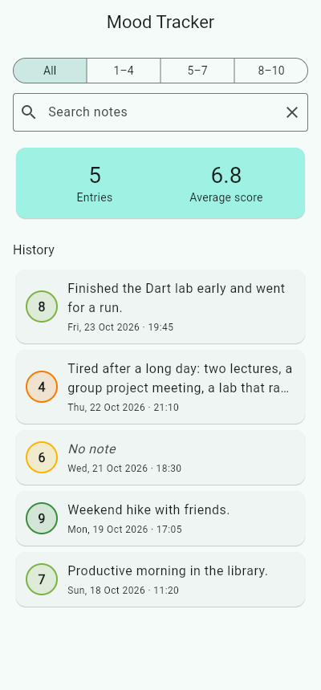
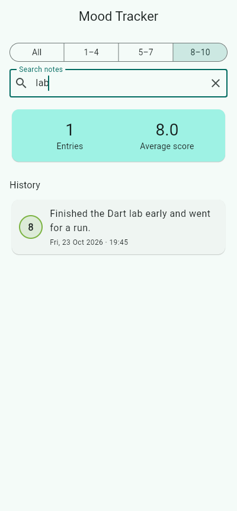
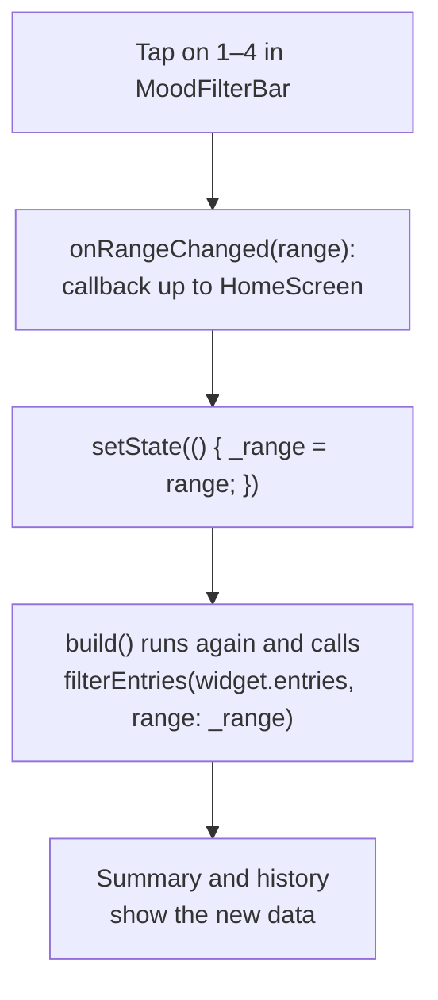
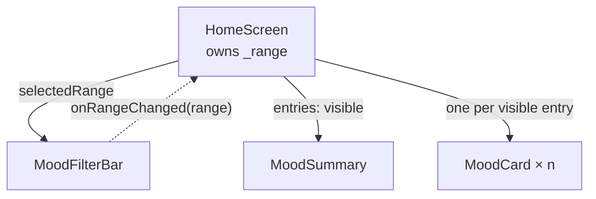
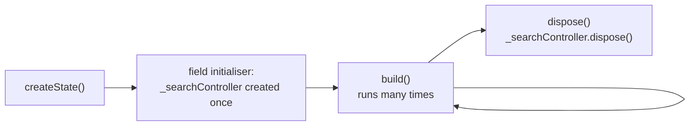

# Lecture 4: Interaction, Local State and Forms


<div class="lab-meta" markdown>
<div class="lab-meta__row"><span class="lab-meta__label">Course</span> Multiplatform Mobile Software Engineering in Practice</div>
<div class="lab-meta__row"><span class="lab-meta__label">Duration</span> 90 min</div>
<div class="lab-meta__row"><span class="lab-meta__label">Prerequisites</span> Lecture 2 (widgets and layout), Lecture 3 (working with a coding agent), Lab 3. Lab 4 follows this lecture in the same meeting</div>
</div>

<div class="grid cards" markdown>

- :material-target:{ .lg .middle } **Learning Outcomes**

    ---

    By the end of this lecture, you will be able to:

    - [ ] Trace a tap through a callback, `setState` and a rebuild, and say which widget owns which state
    - [ ] Keep a `TextEditingController` for the lifetime of its `State` and dispose of it
    - [ ] Specify a screen change as acceptance criteria, delegate it to a coding agent, and review the plan and the diff
    - [ ] Show with a test or a run that a change meets a criterion, and say what a passing `flutter analyze` does not prove

- :material-clock-outline:{ .lg .middle } **Programme (90 min)**

    ---

    | Section | Duration |
    |---------|----------|
    | 1. Today's target | 5 min |
    | 2. Events, callbacks and `setState` | 10 min |
    | 3. Who owns the state? Agent demo 1: a score filter | 20 min |
    | 4. Reviewing an agent's diff | 10 min |
    | 5. Text input and controllers. Agent demo 2: note search | 20 min |
    | 6. Two ways to be wrong | 15 min |
    | 7. Recap, check and Lab 4 | 10 min |

</div>


---

## Get the Code

Today's example lives in the course repository, in three complete projects:

| Folder | What it is |
|---|---|
| `lectures/lecture-04-interaction-state-forms/demo/starter/mood_tracker` | **Start here.** The static Mood Tracker from Lecture 2 (Checkpoint 01) plus `AGENTS.md` for a coding agent |
| `lectures/lecture-04-interaction-state-forms/demo/mid/mood_tracker` | After Section 3: the score filter |
| `lectures/lecture-04-interaction-state-forms/demo/end/mood_tracker` | After Section 5: the score filter and the note search |

The projects ship without platform folders. Copy one out of the repository first:

```bash
cp -r lectures/lecture-04-interaction-state-forms/demo/starter/mood_tracker ~/flutter-work/l04
cd ~/flutter-work/l04
flutter create --platforms=android,ios,web .
flutter pub get
flutter test
flutter run
```

To follow the agent demos yourself, also run `git init && git add -A && git commit -m "Starter"` in the copy, so that you can review every change the agent makes with `git diff`.

---

## 1. Today's Target (5 min)

In Lecture 2 the Mood Tracker screen was a function of fixed data. Today the data a user sees changes while the app runs. We add a **history filter**: choose a score range, search the notes, and both the summary and the history follow.

<div class="grid" markdown>
<figure markdown>
{ width="260" }
<figcaption>When the app starts: All is selected.</figcaption>
</figure>
<figure markdown>
{ width="260" }
<figcaption>After choosing 8–10 and typing "lab".</figcaption>
</figure>
</div>

A coding agent writes the code. We decide what it must do, we read what it wrote, and we prove that it works. This is the same workflow as in Lecture 3, now applied to a screen that changes.

---

## 2. Events, Callbacks and `setState` (10 min)

### A tap runs a callback; `setState` asks Flutter to rebuild



The widget that owns a value changes it **inside `setState`**. `setState` does not draw anything itself: it marks the `State` as needing a rebuild, and Flutter calls `build()` again with the new value. You never redraw by hand. The screen is still a function of its data, but the data can now change.

!!! warning "Common mistake"
    Assigning `_range = range;` without `setState` changes the field but triggers no rebuild. The screen keeps showing the old data until something else happens to rebuild it.

### A `StatefulWidget` is configuration; its `State` holds what changes

A `StatefulWidget` is made of two classes. The widget holds the **configuration** it was given by its parent (`entries`). It is immutable and is recreated on every rebuild. The `State` object is **long-lived**: it survives rebuilds and holds the values that change (`_range`).

```dart
// lib/screens/home_screen.dart (lines 13–29), mid checkpoint
class HomeScreen extends StatefulWidget {
  const HomeScreen({super.key, required this.entries});

  final List<MoodEntry> entries;

  @override
  State<HomeScreen> createState() => _HomeScreenState();
}

class _HomeScreenState extends State<HomeScreen> {
  ScoreRange _range = ScoreRange.all;

  void _changeRange(ScoreRange range) {
    setState(() {
      _range = range;
    });
  }
```

---

## 3. Who Owns the State? Agent Demo 1: A Score Filter (20 min)

### State lives in the lowest widget that every reader shares

When the user taps **1–4**, two widgets must change: the summary and the history. Both must read the same range, so the range lives in their closest shared ancestor, `HomeScreen`. Data flows **down** through constructor parameters; events flow **up** through callbacks.



The filter bar keeps no state of its own. It shows the range it is given and reports taps:

```dart
// lib/widgets/mood_filter_bar.dart (lines 5–35), mid checkpoint
/// Buttons for choosing which score range the history shows.
///
/// The bar keeps no state of its own: the parent passes in [selectedRange]
/// and is told about a new choice through [onRangeChanged].
class MoodFilterBar extends StatelessWidget {
  const MoodFilterBar({
    super.key,
    required this.selectedRange,
    required this.onRangeChanged,
  });

  /// The range that is currently selected.
  final ScoreRange selectedRange;

  /// Called with the range the user picked.
  final ValueChanged<ScoreRange> onRangeChanged;

  @override
  Widget build(BuildContext context) {
    return SegmentedButton<ScoreRange>(
      segments: [
        for (final range in ScoreRange.values)
          ButtonSegment(value: range, label: Text(range.label)),
      ],
      selected: {selectedRange},
      // Exactly one range is always selected, so the set has one element.
      onSelectionChanged: (selection) => onRangeChanged(selection.first),
      showSelectedIcon: false,
    );
  }
}
```

### Specify before you delegate

Before any agent sees the task, write down what "done" means: behaviour that someone else can check by using the app, including what must **not** happen.

!!! example "ACCEPTANCE.md: history filter, criteria 1–4"
    **1.** Above the summary there is a choice of All, 1–4, 5–7 and 8–10. All is selected when the app starts, and exactly one choice is selected at any time.

    **2.** When 1–4 is chosen, the history shows only entries scored 1 to 4, newest first, and the summary's count and average describe only those entries.

    **3.** When no entry matches, the history says "No entries match this filter." instead of showing nothing.

    **4.** Choosing All again shows every entry: filtering never removes entries from the app's data.

Criterion 3 is the edge case. Criterion 4 protects the data, and it is the one that is easiest to break without noticing.

### Brief the agent, then review its plan

The agent reads `AGENTS.md` (commands, project layout, rules such as "do not add packages") and `ACCEPTANCE.md`. Ask for a plan first:

```text
Read AGENTS.md and ACCEPTANCE.md. Plan how to add a score-range filter to the
history that meets criteria 1–4. You may change lib/screens/home_screen.dart,
add one file in lib/models/ and one in lib/widgets/, and add tests in test/.
Do not add packages. Show me the plan before you edit anything.
```

Check the plan before approving it. Does it cover every criterion? Where does it store the range? Does it stay inside the allowed files? A plan that keeps the range inside the filter bar should be rejected: the summary would not see it.

### Reading the diff

One possible result, the `mid` checkpoint. Filtering is a plain function that builds a **new** list, so the original data is never touched (criterion 4):

```dart
// lib/models/mood_filter.dart (lines 25–36), mid checkpoint
/// The entries whose score lies in [range], in their original order.
///
/// Returns a new list; [entries] itself is never changed.
List<MoodEntry> filterEntries(
  List<MoodEntry> entries, {
  ScoreRange range = ScoreRange.all,
}) {
  return [
    for (final entry in entries)
      if (range.contains(entry.score)) entry,
  ];
}
```

`ScoreRange` is an *enhanced enum*: each value carries its label and bounds, and `contains` is a method on it. In `HomeScreen`, `build()` computes the visible entries on every rebuild and stores nothing extra; the `if`/`else` inside the list chooses between the empty-state message and the cards:

```dart
// lib/screens/home_screen.dart (lines 31–70), mid checkpoint
  @override
  Widget build(BuildContext context) {
    final visible = filterEntries(widget.entries, range: _range);

    return Scaffold(
      appBar: AppBar(title: const Text('Mood Tracker')),
      body: SafeArea(
        child: Center(
          child: ConstrainedBox(
            constraints: const BoxConstraints(maxWidth: 640),
            child: ListView(
              padding: const EdgeInsets.all(16),
              children: [
                MoodFilterBar(
                  selectedRange: _range,
                  onRangeChanged: _changeRange,
                ),
                const SizedBox(height: 16),
                MoodSummary(entries: visible),
                const SizedBox(height: 24),
                Text('History', style: Theme.of(context).textTheme.titleMedium),
                const SizedBox(height: 8),
                if (visible.isEmpty)
                  const Padding(
                    padding: EdgeInsets.symmetric(vertical: 24),
                    child: Text(
                      'No entries match this filter.',
                      textAlign: TextAlign.center,
                    ),
                  )
                else
                  for (final entry in visible) MoodCard(entry: entry),
              ],
            ),
          ),
        ),
      ),
    );
  }
}
```

---

## 4. Reviewing an Agent's Diff (10 min)

An agent's code usually looks plausible. Review it against your criteria, not against your impression. Does this version of `filterEntries` meet criteria 1–4?

```dart
// lib/models/mood_filter.dart (a version to review)
List<MoodEntry> filterEntries(
  List<MoodEntry> entries, {
  ScoreRange range = ScoreRange.all,
}) {
  entries.removeWhere((entry) => !range.contains(entry.score));
  return entries;
}
```

??? question "What do you see after tapping 1–4 and then All?"
    Only one entry is left. `removeWhere` deletes entries from the list it was given, which is the app's data, so choosing All afterwards has nothing left to show. This breaks criterion 4. The entries come back only after a restart.

    `flutter analyze` reports **no issues**: the code is well-formed Dart. The unit test *"each band keeps only its own scores"* fails, and so does running the app.

!!! tip "What a passing analyzer means"
    `flutter analyze` checks that code is well-formed: types, imports, lint rules. It cannot know what you asked for. Acceptance criteria, tests that check them, and running the app do.

---

## 5. Text Input and Controllers. Agent Demo 2: Note Search (20 min)

### A `TextEditingController` lives as long as its `State`

A text field's content lives in a **controller**, an object with listeners that stays outside the widget tree. Create it **once**, as a field of a `State`, and release it in `dispose()`. An `int` needs no disposing; a controller does, because it holds listeners.



```dart
// lib/widgets/mood_filter_bar.dart (lines 31–45), end checkpoint
class _MoodFilterBarState extends State<MoodFilterBar> {
  // Created once, when the State is created, so it survives every rebuild.
  final _searchController = TextEditingController();

  @override
  void dispose() {
    // A controller holds listeners; release it when the bar goes away.
    _searchController.dispose();
    super.dispose();
  }

  void _clearSearch() {
    _searchController.clear();
    widget.onQueryChanged('');
  }
```

The bar owns the **controller**, because only its text field uses it. `HomeScreen` owns the **search text**, because the summary and the history need it. `widget.onQueryChanged` reaches the parent's callback from inside the `State`.

### Criteria first, as tests

!!! example "ACCEPTANCE.md: note search, criteria 5–8"
    **5.** A Search notes field below the range choice shows only entries whose note contains the typed text, ignoring letter case and surrounding spaces. An entry without a note never matches a non-empty search.

    **6.** Search and range combine: an entry is shown only if it matches both.

    **7.** A clear button empties the field and shows every entry of the chosen range again.

    **8.** Text typed into the search field stays there when the range changes.

A criterion can become a widget test before the feature exists. `enterText` types, `tap` taps, `pump` lets Flutter rebuild, `expect` checks:

```dart
// test/widget_test.dart (lines 90–106), end checkpoint
testWidgets('typed search text survives a rebuild of the screen', (
  tester,
) async {
  await pumpAppAt(tester, const Size(400, 1600));

  await tester.enterText(find.byType(TextField), 'lab');
  await tester.pump();
  // Changing the range rebuilds HomeScreen and the filter bar.
  await tester.tap(find.text('8–10'));
  await tester.pump();

  expect(
    tester.widget<TextField>(find.byType(TextField)).controller!.text,
    'lab',
  );
  expect(find.byType(MoodCard), findsOneWidget);
});
```

The second prompt has the same structure as the first: criteria, allowed files, plan first, real test output.

```text
Read AGENTS.md and ACCEPTANCE.md; criteria 5–8 are new. Plan how to add the
note search. You may change lib/models/mood_filter.dart,
lib/widgets/mood_filter_bar.dart, lib/screens/home_screen.dart and files in
test/. Show me the plan first. After editing, run flutter analyze and
flutter test and report their actual output.
```

When reviewing, ask: where is the controller created, and is it disposed? Is the search text owned by `HomeScreen`? Is there a test for criterion 8?

### Forms: feedback instead of silence

A search field needs no validation, but most input forms do. Flutter's `Form` groups fields and validates them together. The example below is an illustration with a made-up field; it is not part of the Mood Tracker.

```dart
// Illustration only
final _formKey = GlobalKey<FormState>();

Form(
  key: _formKey,
  child: Column(
    children: [
      TextFormField(
        decoration: const InputDecoration(labelText: 'Team name'),
        validator: (value) => (value == null || value.trim().isEmpty)
            ? 'Enter a team name'
            : null,
      ),
      FilledButton(
        onPressed: () {
          if (_formKey.currentState!.validate()) {
            // Every validator returned null: the input is valid.
          }
        },
        child: const Text('Save'),
      ),
    ],
  ),
);
```

- A **validator** returns an error message, or `null` when the value is valid.
- `validate()` runs every validator in the form and shows the messages under the fields.
- The `GlobalKey<FormState>` is created once in a `State`, like a controller, so that the button can reach the form.
- A disabled button does not tell the user what is wrong; a message does. In Lab 4 Part 3 you delegate exactly this kind of change to an agent, with your own criteria.

---

## 6. Two Ways to Be Wrong (15 min)

### A controller made in `build`

What happens when you type `h` into a search field built like this?

```dart
// lib/widgets/mood_filter_bar.dart (a version to review)
class _MoodFilterBarState extends State<MoodFilterBar> {
  @override
  Widget build(BuildContext context) {
    final searchController = TextEditingController();
    // ... the TextField below uses searchController
```

??? question "Predict, then open"
    The field empties after every keystroke, while the history stays filtered by the last letter typed. Each keystroke calls `onQueryChanged`. `HomeScreen` calls `setState`, the bar rebuilds, and `build` creates a **new, empty** controller. The old controllers are never disposed.

    `flutter analyze` again reports no issues. The test *"typed search text survives a rebuild of the screen"* (criterion 8) fails. Fix: make the controller a field of the `State` and dispose of it in `dispose()`.

### A test that proves nothing

```dart
testWidgets('search works', (tester) async {
  await tester.pumpWidget(const MoodTrackerApp());
  expect(find.byType(TextField), findsOneWidget);
});
```

??? question "Which criterion does this test check?"
    None of criteria 5–8. It passes as long as a text field exists, even if search is completely broken. A useful version types something and checks the result:

    ```dart
    await tester.enterText(find.byType(TextField), 'hike');
    await tester.pump();
    expect(find.byType(MoodCard), findsOneWidget);
    expect(find.text('Weekend hike with friends.'), findsOneWidget);
    ```

    Other good checks: a search in capitals (`'LIBRARY'`) for criterion 5, or text that stays in the field after a range change for criterion 8.

---

## 7. Recap and Comprehension Check (10 min)

Answer on paper first, without AI. Then open the suggested answer.

??? question "1. Which widget owns `_range`, and why not `MoodFilterBar`?"
    `HomeScreen`, because both the summary and the history read the range. State lives in the lowest widget that every reader shares. The bar only shows the range it is given and reports taps through `onRangeChanged`.

??? question "2. Why must the search controller be created outside `build`?"
    `build` runs on every rebuild. A controller created there is replaced each time, which loses the typed text, and the old controllers are never disposed. Create it once as a field of the `State` and dispose of it in `dispose()`.

??? question "3. Name one thing that `flutter analyze` reported as fine today that was wrong."
    The `removeWhere` version of `filterEntries`, which deleted the app's data, and the controller created in `build`, which lost the typed text. Both are well-formed Dart; only the criteria, tests and running the app revealed them.

### Next

- **Lab 4 (straight after this lecture):** you add the **mood-entry form** to the same app. Parts 1–2 are **by hand, without AI**: `setState` for the chosen score, a note controller with `dispose`, and moving the list of entries into `HomeScreen`. Part 3 is your first agent-assisted task: validation messages instead of a disabled button. Write `ACCEPTANCE.md` before the agent sees the task. Set up GitHub Copilot or Mistral Vibe beforehand if you have not yet.
- **Lecture 5: Application Architecture, Shared State and Navigation.** Several screens that share the same data.

---

## Quick Quiz

<quiz>
A widget assigns `_range = range;` in a tap handler but does not call `setState`. What happens?

- [ ] The app does not compile
- [x] The field changes, but the screen keeps showing the old data until something else triggers a rebuild
- [ ] Flutter rebuilds the whole app
- [ ] The value is lost immediately
</quiz>

<quiz>
The summary and the history must both show only the filtered entries. Where should the selected range be stored?

- [ ] In `MoodFilterBar`, because it shows the buttons
- [ ] In each `MoodCard`
- [x] In `HomeScreen`, the closest widget that contains both readers
- [ ] In a global variable
</quiz>

<quiz>
Where should a `TextEditingController` be created?

- [ ] Inside `build`, so that it is always fresh
- [x] Once, as a field of the `State`, and disposed in `dispose()`
- [ ] In `main()`
- [ ] It does not matter, because Flutter manages controllers automatically
</quiz>

<quiz>
`flutter analyze` reports "No issues found!" after an agent's change. What does that show?

- [ ] The change meets the acceptance criteria
- [x] The code is well-formed (types, imports, lint rules); it says nothing about whether it does what you asked
- [ ] All tests pass
- [ ] The app runs on Android and iOS
</quiz>

<quiz>
Why ask a coding agent for a plan before it edits anything?

- [ ] Agents cannot edit without a plan
- [ ] It makes the agent faster
- [x] You can check the plan against your criteria and the allowed files, and correct it before any code changes
- [ ] The plan replaces the code review
</quiz>

---

## Further Reading

- [Agentic SDLC: From Idea to Merge](../../guides/agentic-sdlc/README.md): today's workflow applied to a whole feature, from the goal to a merged pull request.

## Code and Verification

The code on this page is quoted from the `demo/mid` and `demo/end` projects. The two "versions to review" are deliberately faulty and are not in the repository. Checked with **Flutter 3.35.4 / Dart 3.9.2**: `flutter analyze` reports no issues in all three projects. The tests pass: 7 in `starter`, 13 in `mid` and 19 in `end`. The `end` project was also run as a web build in a browser (screenshots above) and on an Android emulator (Pixel 8, Android 16). It has not been checked on iOS or on a physical device.

## Sources

Official documentation, consulted in November 2026; Flutter changes often, so re-check before relying on details.

- [Flutter: Adding interactivity](https://docs.flutter.dev/ui/interactivity)
- [Flutter: Build a form with validation](https://docs.flutter.dev/cookbook/forms/validation) and [Handle changes to a text field](https://docs.flutter.dev/cookbook/forms/text-field-changes)
- [Flutter: An introduction to widget testing](https://docs.flutter.dev/cookbook/testing/widget/introduction)
- API reference: [State](https://api.flutter.dev/flutter/widgets/State-class.html), [State.setState](https://api.flutter.dev/flutter/widgets/State/setState.html), [State.dispose](https://api.flutter.dev/flutter/widgets/State/dispose.html), [TextEditingController](https://api.flutter.dev/flutter/widgets/TextEditingController-class.html), [SegmentedButton](https://api.flutter.dev/flutter/material/SegmentedButton-class.html), [Form](https://api.flutter.dev/flutter/widgets/Form-class.html), [FormState.validate](https://api.flutter.dev/flutter/widgets/FormState/validate.html)
